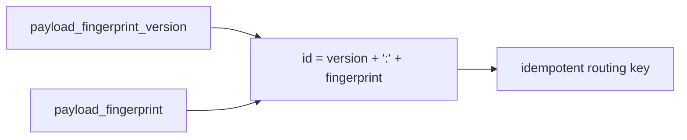

# 2026-10-31：Stage 1724 —— source-monitor gate_health 阻塞原因增量变化状态载荷指纹标识符

[English](2026-10-31-source-monitor-gate-health-blocking-reasons-delta-change-state-payload-fingerprint-id.en.md) | [阶段索引](../stage-archive-index.md)

## 背景与目标

Stage 1723 已提供 payload 指纹及其版本。  
下游在做幂等键、分区键或告警去重时，仍需手工拼接 `<version>:<fingerprint>`。

Stage 1724 新增 `blocking_reasons_delta_change_state_payload_fingerprint_id`，直接输出版本化指纹标识符。

## 实现

### `scripts/source_monitor.py`

- 新增字段：
  - `gate_health.blocking_reasons_delta_change_state_payload_fingerprint_id`
- 语义：
  - 若 payload 指纹为空（baseline），输出 `null`；
  - 若 payload 指纹存在，输出：
    `"<payload_fingerprint_version>:<payload_fingerprint>"`。

### `tests/test_source_monitor.py`

- baseline 场景断言 `...payload_fingerprint_id is None`；
- changed/unchanged 场景断言：
  `...payload_fingerprint_id == "<version>:<fingerprint>"`；
- 其余回归保持通过。

## 图示（版本化指纹 ID）



## 验证

北京时间白天授权窗口内执行：

```bash
python -m pytest tests/test_source_monitor.py -q
python -m pytest -q
python scripts/source_monitor.py --registry research/sources.json --output-dir research/daily
```

结果：
- `tests/test_source_monitor.py`：`43 passed, 6 subtests passed`；
- 全量回归：`4267 passed, 1089 subtests passed`；
- 刷新后的 `research/daily/2026-10-31-sources.json` 已包含
  `gate_health.blocking_reasons_delta_change_state_payload_fingerprint_id`。

## 架构影响

1. **幂等键可直接消费**：下游可直接使用版本化指纹 ID 进行去重和分区。  
2. **减少重复拼接逻辑**：消费者无需重复实现 version+fingerprint 拼接。  
3. **边界不变**：仍为公开来源抓取与离线聚合，不涉及支付执行或账户权限。
