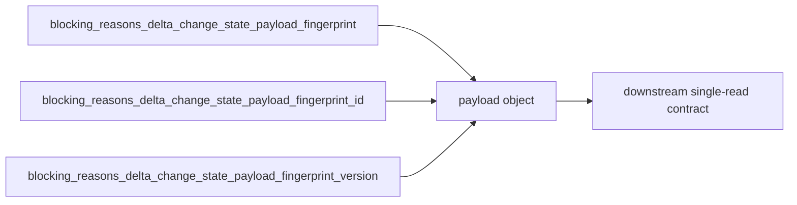

# 2026-10-31: Stage 1725 — Source monitor gate_health blocking-reasons delta change-state payload fingerprint structured payload

[中文](2026-10-31-source-monitor-gate-health-blocking-reasons-delta-change-state-payload-fingerprint-payload.md) | [Stage archive index](../stage-archive-index.md)

## Background and objective

Stage 1724 already introduced a versioned fingerprint ID.  
When downstream systems need the full `version/fingerprint/id` triple, they still have to recompose it from separate fields.

Stage 1725 adds `blocking_reasons_delta_change_state_payload_fingerprint_payload`,
bundling all three values into one structured object for single-read consumption.

## Implementation

### `scripts/source_monitor.py`

- Added field:
  - `gate_health.blocking_reasons_delta_change_state_payload_fingerprint_payload`
- Semantics:
  - emits `null` when payload fingerprint is absent (baseline);
  - when payload fingerprint exists, emits:
    - `version`: `sha256-change-state-payload-v1`
    - `fingerprint`: payload fingerprint (SHA-256)
    - `id`: `<version>:<fingerprint>`

### `tests/test_source_monitor.py`

- Baseline assertion: `...payload_fingerprint_payload is None`;
- Changed/unchanged assertions:
  `...payload_fingerprint_payload == {version, fingerprint, id}`;
- Existing regression assertions remain unchanged.

## Visual map (single-read fingerprint triple)



## Validation

Executed during the user-authorized daytime window:

```bash
python -m pytest tests/test_source_monitor.py -q
python -m pytest -q
python scripts/source_monitor.py --registry research/sources.json --output-dir research/daily
```

Results:
- `tests/test_source_monitor.py`: `43 passed, 6 subtests passed`;
- full regression: `4267 passed, 1089 subtests passed`;
- refreshed `research/daily/2026-10-31-sources.json` now includes
  `gate_health.blocking_reasons_delta_change_state_payload_fingerprint_payload`.

## Architecture impact

1. **Stronger single-field contract:** downstream no longer needs client-side object reconstruction from three separate fields.  
2. **Complete idempotency/audit context:** version, fingerprint, and ID are emitted together for partitioning and audit traces.  
3. **Boundary unchanged:** still public-source retrieval plus offline aggregation, with no live payment execution or account authority.
