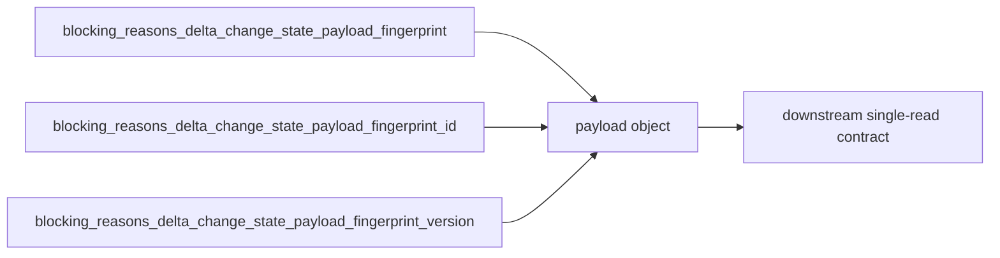

# 2026-10-31：Stage 1725 —— source-monitor gate_health 阻塞原因增量变化状态载荷指纹结构化载荷

[English](2026-10-31-source-monitor-gate-health-blocking-reasons-delta-change-state-payload-fingerprint-payload.en.md) | [阶段索引](../stage-archive-index.md)

## 背景与目标

Stage 1724 已提供版本化指纹 ID。  
下游若要同时读取 `version/fingerprint/id` 三元信息，仍需跨字段拼装。

Stage 1725 新增 `blocking_reasons_delta_change_state_payload_fingerprint_payload`，
将这三项信息合并为单个结构化对象，供下游一次读取。

## 实现

### `scripts/source_monitor.py`

- 新增字段：
  - `gate_health.blocking_reasons_delta_change_state_payload_fingerprint_payload`
- 语义：
  - 若 payload 指纹为空（baseline），输出 `null`；
  - 若 payload 指纹存在，输出：
    - `version`：`sha256-change-state-payload-v1`
    - `fingerprint`：payload 指纹（SHA-256）
    - `id`：`<version>:<fingerprint>`

### `tests/test_source_monitor.py`

- baseline 场景断言 `...payload_fingerprint_payload is None`；
- changed/unchanged 场景断言：
  `...payload_fingerprint_payload == {version, fingerprint, id}`；
- 保持既有回归断言不变。

## 图示（指纹三元信息一次读取）



## 验证

北京时间白天授权窗口内执行：

```bash
python -m pytest tests/test_source_monitor.py -q
python -m pytest -q
python scripts/source_monitor.py --registry research/sources.json --output-dir research/daily
```

结果：
- `tests/test_source_monitor.py`：`43 passed, 6 subtests passed`；
- 全量回归：`4267 passed, 1089 subtests passed`；
- 刷新后的 `research/daily/2026-10-31-sources.json` 已包含
  `gate_health.blocking_reasons_delta_change_state_payload_fingerprint_payload`。

## 架构影响

1. **单字段契约增强**：下游无需再跨三个字段做对象重建。  
2. **幂等与审计上下文齐备**：版本、指纹、ID 同时输出，方便审计与分区。  
3. **边界不变**：仍为公开来源抓取与离线聚合，不涉及真实支付或账户权限。
