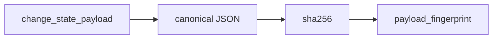

# 2026-10-31: Stage 1722 — Source monitor gate_health blocking-reasons delta change-state payload fingerprint

[中文](2026-10-31-source-monitor-gate-health-blocking-reasons-delta-change-state-payload-fingerprint.md) | [Stage archive index](../stage-archive-index.md)

## Background and objective

Stage 1721 introduced `blocking_reasons_delta_change_state_payload` as a structured object.  
For single-value dedupe, audit comparison, and cache-key usage, downstream systems still needed to hash that payload themselves.

Stage 1722 adds `blocking_reasons_delta_change_state_payload_fingerprint` as a stable SHA-256 digest.

## Implementation

### `scripts/source_monitor.py`

- Added field:
  - `gate_health.blocking_reasons_delta_change_state_payload_fingerprint`
- Semantics:
  - emits `null` when payload is absent (baseline);
  - when payload exists, computes SHA-256 over canonical payload JSON
    (`sort_keys=True`, `separators=(",", ":")`).

### `tests/test_source_monitor.py`

- Baseline assertion: `...payload_fingerprint is None`;
- Changed/unchanged assertions each verify:
  `...payload_fingerprint == sha256(canonical_json(payload))`;
- Remaining regression remains green.

## Visual map (payload fingerprint)



## Validation

Executed during the user-authorized daytime window:

```bash
python -m pytest tests/test_source_monitor.py -q
python -m pytest -q
python scripts/source_monitor.py --registry research/sources.json --output-dir research/daily
```

Results:
- `tests/test_source_monitor.py`: `43 passed, 6 subtests passed`;
- full regression: `4267 passed, 1089 subtests passed`;
- refreshed `research/daily/2026-10-31-sources.json` now includes
  `gate_health.blocking_reasons_delta_change_state_payload_fingerprint`.

## Architecture impact

1. **Faster single-value reconciliation:** consumers can use one digest for dedupe and equality checks.  
2. **Replayable audit trail:** structured payload and digest coexist for readability plus machine comparison.  
3. **Boundary unchanged:** still public-source retrieval and offline aggregation, with no payment execution or account authority.
