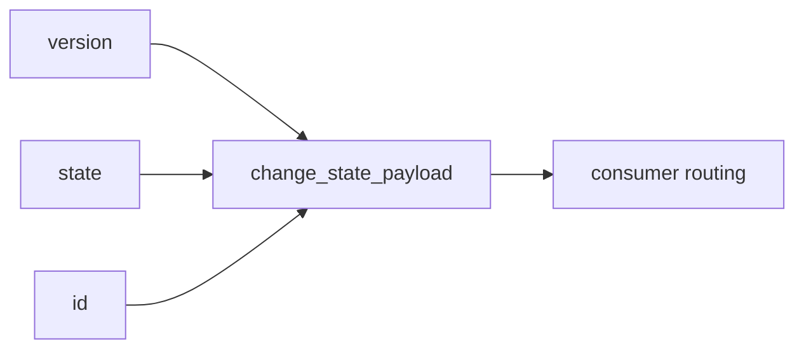

# 2026-10-31: Stage 1721 — Source monitor gate_health blocking-reasons delta change-state structured payload

[中文](2026-10-31-source-monitor-gate-health-blocking-reasons-delta-change-state-payload.md) | [Stage archive index](../stage-archive-index.md)

## Background and objective

Stage 1720 introduced `blocking_reasons_delta_change_state_id` as a single-value key.  
When consumers need version, state, and ID together, they still have to split or reconstruct fields.

Stage 1721 adds `blocking_reasons_delta_change_state_payload` as one structured object.

## Implementation

### `scripts/source_monitor.py`

- Added field:
  - `gate_health.blocking_reasons_delta_change_state_payload`
- Semantics:
  - emits `null` when state is absent (baseline);
  - when state exists, emits:
    - `version`: `reasons-delta-change-state-v1`
    - `state`: `changed` / `unchanged`
    - `id`: `<version>:<state>`

### `tests/test_source_monitor.py`

- Baseline assertion: `blocking_reasons_delta_change_state_payload is None`;
- Changed assertion: payload equals `{version,state,id}` (`changed`);
- Unchanged assertion: payload equals `{version,state,id}` (`unchanged`);
- Remaining regression remains green.

## Visual map (structured state payload)



## Validation

Executed during the user-authorized daytime window:

```bash
python -m pytest tests/test_source_monitor.py -q
python -m pytest -q
python scripts/source_monitor.py --registry research/sources.json --output-dir research/daily
```

Results:
- `tests/test_source_monitor.py`: `43 passed, 6 subtests passed`;
- full regression: `4267 passed, 1089 subtests passed`;
- refreshed `research/daily/2026-10-31-sources.json` now includes
  `gate_health.blocking_reasons_delta_change_state_payload`.

## Architecture impact

1. **Lower consumer complexity:** downstream logic reads structured fields directly without string parsing.  
2. **Smoother protocol evolution:** payload can add fields incrementally without breaking single-value IDs.  
3. **Boundary unchanged:** still public-source retrieval and offline aggregation, with no payment execution or account authority.
