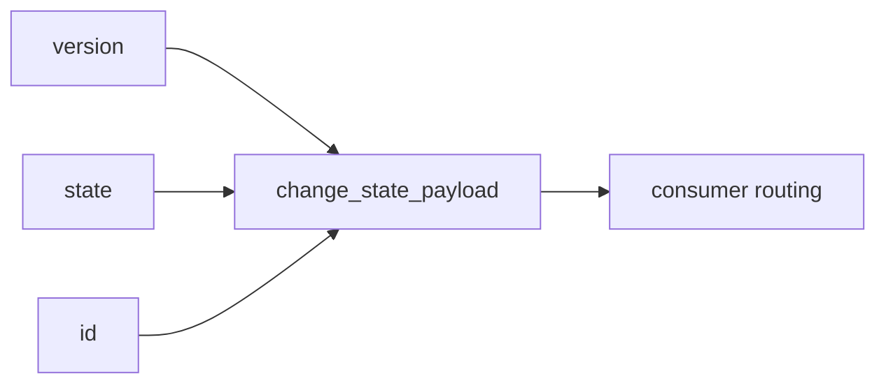

# 2026-10-31：Stage 1721 —— source-monitor gate_health 阻塞原因增量变化状态结构化载荷

[English](2026-10-31-source-monitor-gate-health-blocking-reasons-delta-change-state-payload.en.md) | [阶段索引](../stage-archive-index.md)

## 背景与目标

Stage 1720 已提供 `blocking_reasons_delta_change_state_id` 单值标识符。  
下游若要同时读取版本、状态与标识符，仍需自行拆解或二次拼装。

Stage 1721 新增 `blocking_reasons_delta_change_state_payload`，统一输出结构化载荷。

## 实现

### `scripts/source_monitor.py`

- 新增字段：
  - `gate_health.blocking_reasons_delta_change_state_payload`
- 语义：
  - 若状态不存在（baseline），输出 `null`；
  - 若状态存在，输出：
    - `version`：`reasons-delta-change-state-v1`
    - `state`：`changed` / `unchanged`
    - `id`：`<version>:<state>`

### `tests/test_source_monitor.py`

- baseline 场景断言 `blocking_reasons_delta_change_state_payload is None`；
- changed 场景断言 payload 为 `{version,state,id}`（`changed`）；
- unchanged 场景断言 payload 为 `{version,state,id}`（`unchanged`）；
- 其余回归保持通过。

## 图示（结构化变化状态载荷）



## 验证

北京时间白天授权窗口内执行：

```bash
python -m pytest tests/test_source_monitor.py -q
python -m pytest -q
python scripts/source_monitor.py --registry research/sources.json --output-dir research/daily
```

结果：
- `tests/test_source_monitor.py`：`43 passed, 6 subtests passed`；
- 全量回归：`4267 passed, 1089 subtests passed`；
- 刷新后的 `research/daily/2026-10-31-sources.json` 已包含
  `gate_health.blocking_reasons_delta_change_state_payload`。

## 架构影响

1. **消费端更轻量**：下游无需拆分字符串，直接读取结构化字段。  
2. **协议扩展更平滑**：后续可在 payload 内增量扩展而不破坏单值 ID。  
3. **边界不变**：仍为公开来源抓取与离线聚合，不涉及支付执行或账户权限。
