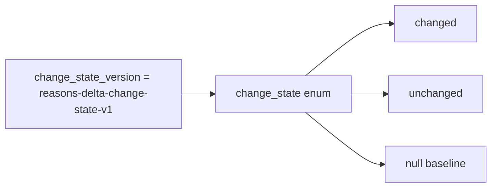

# 2026-10-31: Stage 1719 — Source monitor gate_health blocking-reasons delta change-state version contract

[中文](2026-10-31-source-monitor-gate-health-blocking-reasons-delta-change-state-version.md) | [Stage archive index](../stage-archive-index.md)

## Background and objective

Stage 1718 introduced `blocking_reasons_delta_change_state` enum output.  
To avoid silent semantic drift when enum values evolve, downstream systems need an explicit enum-contract version.

Stage 1719 adds `blocking_reasons_delta_change_state_version` as a fixed version declaration.

## Implementation

### `scripts/source_monitor.py`

- Added constant:
  - `BLOCKING_REASONS_DELTA_CHANGE_STATE_VERSION = "reasons-delta-change-state-v1"`
- Added field:
  - `gate_health.blocking_reasons_delta_change_state_version`
- Semantics:
  - always emits `reasons-delta-change-state-v1`;
  - consumed together with `blocking_reasons_delta_change_state` for version-aware downstream logic.

### `tests/test_source_monitor.py`

- Baseline/changed/unchanged assertions all verify:
  `blocking_reasons_delta_change_state_version == "reasons-delta-change-state-v1"`;
- existing `blocking_reasons_delta_change_state` assertions remain unchanged;
- remaining regression stays green.

## Visual map (versioned enum contract)



## Validation

Executed during the user-authorized daytime window:

```bash
python -m pytest tests/test_source_monitor.py -q
python -m pytest -q
python scripts/source_monitor.py --registry research/sources.json --output-dir research/daily
```

Results:
- `tests/test_source_monitor.py`: `43 passed, 6 subtests passed`;
- full regression: `4267 passed, 1089 subtests passed`;
- refreshed `research/daily/2026-10-31-sources.json` now includes
  `gate_health.blocking_reasons_delta_change_state_version`.

## Architecture impact

1. **Governable enum evolution:** downstream consumers can branch on explicit version to preserve compatibility.  
2. **Auditable contract surface:** state enum and enum-version stay together in `gate_health` for replayability.  
3. **Boundary unchanged:** still public-source retrieval and offline aggregation, with no payment execution or account authority.
