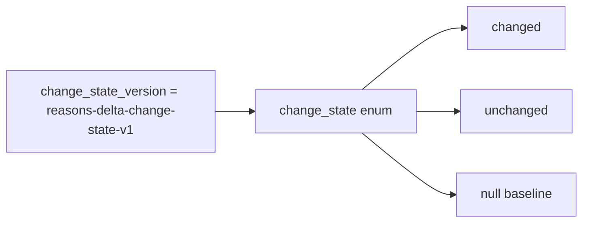

# 2026-10-31：Stage 1719 —— source-monitor gate_health 阻塞原因增量变化状态版本契约

[English](2026-10-31-source-monitor-gate-health-blocking-reasons-delta-change-state-version.en.md) | [阶段索引](../stage-archive-index.md)

## 背景与目标

Stage 1718 已新增 `blocking_reasons_delta_change_state` 状态枚举。  
为避免下游在未来枚举扩展时静默漂移，需显式输出该枚举语义版本。

Stage 1719 新增 `blocking_reasons_delta_change_state_version`，固定声明当前枚举契约版本。

## 实现

### `scripts/source_monitor.py`

- 新增常量：
  - `BLOCKING_REASONS_DELTA_CHANGE_STATE_VERSION = "reasons-delta-change-state-v1"`
- 新增字段：
  - `gate_health.blocking_reasons_delta_change_state_version`
- 语义：
  - 所有场景固定输出 `reasons-delta-change-state-v1`；
  - 与 `blocking_reasons_delta_change_state` 联合使用，支持下游版本感知消费。

### `tests/test_source_monitor.py`

- baseline / changed / unchanged 场景均断言：
  `blocking_reasons_delta_change_state_version == "reasons-delta-change-state-v1"`；
- 并保持既有 `blocking_reasons_delta_change_state` 断言不变；
- 其余回归保持通过。

## 图示（版本化枚举契约）



## 验证

北京时间白天授权窗口内执行：

```bash
python -m pytest tests/test_source_monitor.py -q
python -m pytest -q
python scripts/source_monitor.py --registry research/sources.json --output-dir research/daily
```

结果：
- `tests/test_source_monitor.py`：`43 passed, 6 subtests passed`；
- 全量回归：`4267 passed, 1089 subtests passed`；
- 刷新后的 `research/daily/2026-10-31-sources.json` 已包含
  `gate_health.blocking_reasons_delta_change_state_version`。

## 架构影响

1. **枚举演进可治理**：下游可按版本号做兼容分支，降低语义漂移风险。  
2. **契约可审计**：变化状态与版本号同处 gate_health，方便审计回放。  
3. **边界不变**：仍为公开来源抓取与离线聚合，不涉及支付执行或账户权限。
