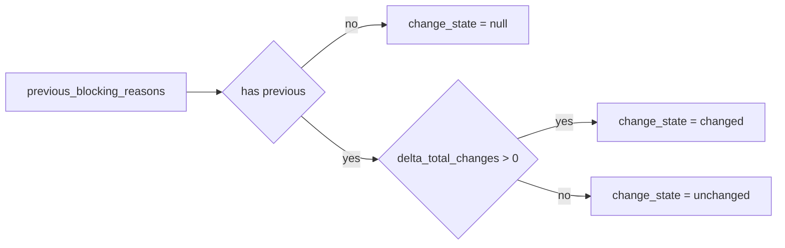

# 2026-10-31: Stage 1718 — Source monitor gate_health blocking-reasons delta change-state telemetry

[中文](2026-10-31-source-monitor-gate-health-blocking-reasons-delta-change-state.md) | [Stage archive index](../stage-archive-index.md)

## Background and objective

Stage 1717 already introduced `blocking_reasons_delta_has_change` as a boolean signal.  
When downstream policies prefer explicit enum states instead of booleans, they still need local mapping.

Stage 1718 adds `blocking_reasons_delta_change_state` as a direct change-state enum.

## Implementation

### `scripts/source_monitor.py`

- Added field:
  - `gate_health.blocking_reasons_delta_change_state`
- Semantics:
  - emits `null` when no prior reasons exist (`previous_blocking_reasons is None`);
  - with prior reasons and `blocking_reasons_delta_total_changes > 0`, emits `"changed"`;
  - with prior reasons and `blocking_reasons_delta_total_changes == 0`, emits `"unchanged"`.

### `tests/test_source_monitor.py`

- Baseline assertion: `blocking_reasons_delta_change_state is None`;
- Changed assertion: `blocking_reasons_delta_change_state == "changed"`;
- Unchanged assertion: `blocking_reasons_delta_change_state == "unchanged"`;
- Remaining regression remains green.

## Visual map (enum mapping)



## Validation

Executed during the user-authorized daytime window:

```bash
python -m pytest tests/test_source_monitor.py -q
python -m pytest -q
python scripts/source_monitor.py --registry research/sources.json --output-dir research/daily
```

Results:
- `tests/test_source_monitor.py`: `43 passed, 6 subtests passed`;
- full regression: `4267 passed, 1089 subtests passed`;
- refreshed `research/daily/2026-10-31-sources.json` now includes
  `gate_health.blocking_reasons_delta_change_state` (current baseline run: `null`).

## Architecture impact

1. **More stable consumption contract:** enum states are easier for cross-language and low-code consumers.  
2. **More readable policy logic:** rules can directly match `"changed"`/`"unchanged"` without local remapping.  
3. **Boundary unchanged:** still public-source retrieval and offline aggregation, with no payment execution or account authority.
