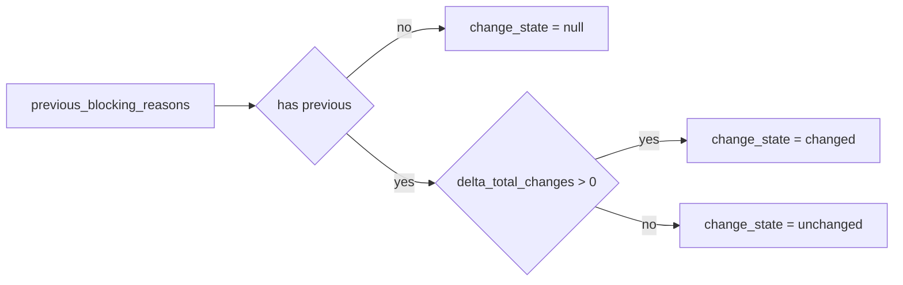

# 2026-10-31：Stage 1718 —— source-monitor gate_health 阻塞原因增量变化状态枚举信号

[English](2026-10-31-source-monitor-gate-health-blocking-reasons-delta-change-state.en.md) | [阶段索引](../stage-archive-index.md)

## 背景与目标

Stage 1717 已提供 `blocking_reasons_delta_has_change` 布尔信号。  
当下游希望使用可读状态枚举而非布尔值进行规则编排时，仍需自行映射。

Stage 1718 新增 `blocking_reasons_delta_change_state`，直接输出变化状态枚举。

## 实现

### `scripts/source_monitor.py`

- 新增字段：
  - `gate_health.blocking_reasons_delta_change_state`
- 语义：
  - 若无前态原因（`previous_blocking_reasons is None`），输出 `null`；
  - 若有前态原因且 `blocking_reasons_delta_total_changes > 0`，输出 `"changed"`；
  - 若有前态原因且 `blocking_reasons_delta_total_changes == 0`，输出 `"unchanged"`。

### `tests/test_source_monitor.py`

- baseline 场景断言 `blocking_reasons_delta_change_state is None`；
- changed 场景断言 `blocking_reasons_delta_change_state == "changed"`；
- unchanged 场景断言 `blocking_reasons_delta_change_state == "unchanged"`；
- 其余回归保持通过。

## 图示（状态枚举映射）



## 验证

北京时间白天授权窗口内执行：

```bash
python -m pytest tests/test_source_monitor.py -q
python -m pytest -q
python scripts/source_monitor.py --registry research/sources.json --output-dir research/daily
```

结果：
- `tests/test_source_monitor.py`：`43 passed, 6 subtests passed`；
- 全量回归：`4267 passed, 1089 subtests passed`；
- 刷新后的 `research/daily/2026-10-31-sources.json` 已包含
  `gate_health.blocking_reasons_delta_change_state`（当前 baseline run 为 `null`）。

## 架构影响

1. **消费协议更稳定**：状态枚举便于跨语言/低代码系统直接消费。  
2. **策略表达更直观**：规则可直接匹配 `"changed"`/`"unchanged"`，减少二次映射。  
3. **边界不变**：仍为公开来源抓取与离线聚合，不涉及支付执行或账户权限。
