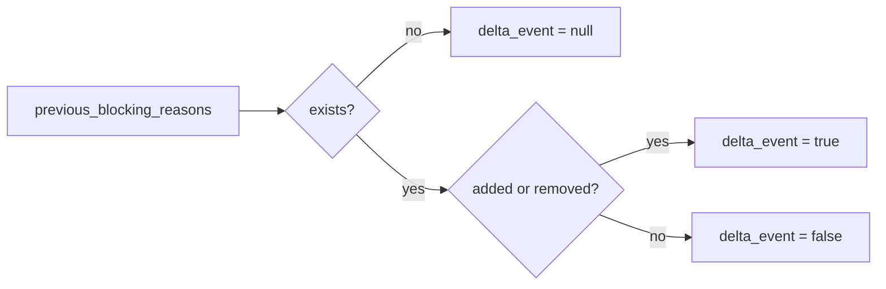

# 2026-10-31: Stage 1708 — Source monitor gate_health blocking-reasons delta event telemetry

[中文](2026-10-31-source-monitor-gate-health-blocking-reasons-delta-event.md) | [Stage archive index](../stage-archive-index.md)

## Background and objective

Stage 1707 already provides the reason-delta fingerprint.  
Downstream routers often need a quick first branch: whether a reason-delta event exists at all, before loading detailed delta objects.

Stage 1708 adds boolean `blocking_reasons_delta_event`.

## Implementation

### `scripts/source_monitor.py`

- Added field:
  - `gate_health.blocking_reasons_delta_event`
- Semantics:
  - if no prior reasons exist (`previous_blocking_reasons is None`), emits `null`;
  - if prior reasons exist and either `added` or `removed` is non-empty, emits `true`;
  - if prior reasons exist and no changes are present, emits `false`.

### `tests/test_source_monitor.py`

- Baseline assertion: `blocking_reasons_delta_event is None`;
- Changed assertion: `blocking_reasons_delta_event is True`;
- Unchanged assertion: `blocking_reasons_delta_event is False`;
- Remaining regression stays green.

## Visual map (reason-delta event bit)



## Validation

Executed during the user-authorized daytime window:

```bash
python -m pytest tests/test_source_monitor.py -q
python -m pytest -q
python scripts/source_monitor.py --registry research/sources.json --output-dir research/daily
```

Results:
- `tests/test_source_monitor.py`: `41 passed, 6 subtests passed`;
- full regression: `4265 passed, 1089 subtests passed`;
- refreshed `research/daily/2026-10-31-sources.json` now includes
  `gate_health.blocking_reasons_delta_event` (current baseline run: `null`).

## Architecture impact

1. **Lower routing overhead:** downstream systems can use a boolean gate before loading detailed deltas.  
2. **Clearer event semantics:** `delta_event` plus `delta_fingerprint` forms a two-layer signal (decision + dedup).  
3. **Boundary unchanged:** still public-source retrieval and offline aggregation, with no payment execution or account authority.
