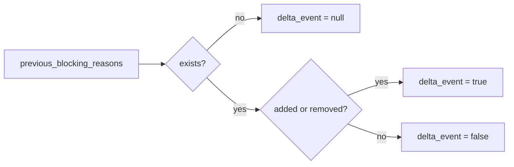

# 2026-10-31：Stage 1708 —— source-monitor gate_health 阻塞原因增量事件信号

[English](2026-10-31-source-monitor-gate-health-blocking-reasons-delta-event.en.md) | [阶段索引](../stage-archive-index.md)

## 背景与目标

Stage 1707 已提供阻塞原因增量指纹。  
下游路由器仍常需要先判断“是否存在原因增量事件”，再决定是否拉取详细增量对象。

Stage 1708 新增布尔位 `blocking_reasons_delta_event`。

## 实现

### `scripts/source_monitor.py`

- 新增字段：
  - `gate_health.blocking_reasons_delta_event`
- 语义：
  - 若无前态原因（`previous_blocking_reasons is None`），输出 `null`；
  - 若存在前态原因，且 `added` 或 `removed` 非空，输出 `true`；
  - 若存在前态原因但无变化，输出 `false`。

### `tests/test_source_monitor.py`

- baseline 场景断言 `blocking_reasons_delta_event is None`；
- changed 场景断言 `blocking_reasons_delta_event is True`；
- unchanged 场景断言 `blocking_reasons_delta_event is False`；
- 其余回归保持通过。

## 图示（原因增量事件位）



## 验证

北京时间白天授权窗口内执行：

```bash
python -m pytest tests/test_source_monitor.py -q
python -m pytest -q
python scripts/source_monitor.py --registry research/sources.json --output-dir research/daily
```

结果：
- `tests/test_source_monitor.py`：`41 passed, 6 subtests passed`；
- 全量回归：`4265 passed, 1089 subtests passed`；
- 刷新后的 `research/daily/2026-10-31-sources.json` 已包含
  `gate_health.blocking_reasons_delta_event`（当前 baseline run 为 `null`）。

## 架构影响

1. **路由开销更低**：下游可用布尔位快速判断是否需要展开增量详情。  
2. **事件语义更清晰**：`delta_event` 与 `delta_fingerprint` 形成“判定 + 去重”双层信号。  
3. **边界不变**：仍是公开来源抓取与离线聚合，不涉及支付执行或账户权限。
