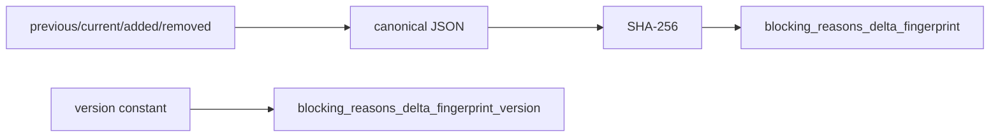

# 2026-10-31: Stage 1707 — Source monitor gate_health blocking-reasons delta fingerprint telemetry

[中文](2026-10-31-source-monitor-gate-health-blocking-reasons-delta-fingerprint.md) | [Stage archive index](../stage-archive-index.md)

## Background and objective

Stage 1706 already emits reason deltas (`previous/added/removed`).  
Downstream pipelines still need a single-value key for idempotent deduplication of reason-delta events.

Stage 1707 adds `blocking_reasons_delta_fingerprint` and its version field.

## Implementation

### `scripts/source_monitor.py`

- Added constant:
  - `BLOCKING_REASONS_DELTA_FINGERPRINT_VERSION = "sha256-reasons-delta-v1"`
- Computes SHA-256 over canonical JSON of `{previous,current,added,removed}`:
  - `gate_health.blocking_reasons_delta_fingerprint`
- Added version field:
  - `gate_health.blocking_reasons_delta_fingerprint_version`
- Semantics:
  - when prior reasons are unavailable (`previous_blocking_reasons is None`), fingerprint is `null`;
  - when prior reasons exist, emits a 64-char hex fingerprint.

### `tests/test_source_monitor.py`

- Baseline assertions verify fixed version and `None` fingerprint;
- Changed/unchanged assertions verify fixed version and 64-char fingerprint;
- Added version-constant stability guard test.

## Visual map (reason-delta fingerprint)



## Validation

Executed during the user-authorized daytime window:

```bash
python -m pytest tests/test_source_monitor.py -q
python -m pytest -q
python scripts/source_monitor.py --registry research/sources.json --output-dir research/daily
```

Results:
- `tests/test_source_monitor.py`: `41 passed, 6 subtests passed`;
- full regression: `4265 passed, 1089 subtests passed`;
- refreshed `research/daily/2026-10-31-sources.json` now includes
  `gate_health.blocking_reasons_delta_fingerprint_version = "sha256-reasons-delta-v1"`,
  and for current baseline run `blocking_reasons_delta_fingerprint` is `null`.

## Architecture impact

1. **Reason-delta deduplication is more efficient:** downstream systems can use one fingerprint value as an idempotency key.  
2. **Cross-system interpretation is steadier:** version + fingerprint pairing reduces semantic drift.  
3. **Boundary unchanged:** still public-source retrieval and offline aggregation, with no payment execution or account authority.
