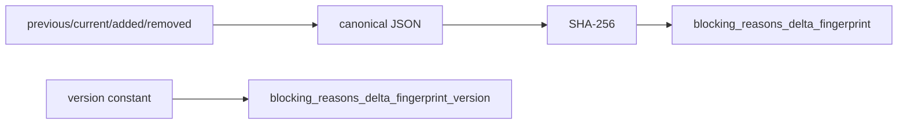

# 2026-10-31：Stage 1707 —— source-monitor gate_health 阻塞原因增量指纹信号

[English](2026-10-31-source-monitor-gate-health-blocking-reasons-delta-fingerprint.en.md) | [阶段索引](../stage-archive-index.md)

## 背景与目标

Stage 1706 已输出阻塞原因增量（previous/added/removed）。  
下游仍需要单值键来做增量事件去重与幂等处理。

Stage 1707 新增 `blocking_reasons_delta_fingerprint` 及版本字段。

## 实现

### `scripts/source_monitor.py`

- 新增常量：
  - `BLOCKING_REASONS_DELTA_FINGERPRINT_VERSION = "sha256-reasons-delta-v1"`
- 对 `{previous,current,added,removed}` 规范化 JSON 计算 SHA-256：
  - `gate_health.blocking_reasons_delta_fingerprint`
- 新增版本字段：
  - `gate_health.blocking_reasons_delta_fingerprint_version`
- 语义：
  - 无前态原因时（`previous_blocking_reasons is None`），指纹为 `null`；
  - 有前态原因时输出 64 位十六进制指纹。

### `tests/test_source_monitor.py`

- baseline 场景断言版本固定、指纹为 `None`；
- changed/unchanged 场景断言版本固定且指纹长度为 64；
- 新增常量稳定性测试，防止版本漂移。

## 图示（原因增量指纹）



## 验证

北京时间白天授权窗口内执行：

```bash
python -m pytest tests/test_source_monitor.py -q
python -m pytest -q
python scripts/source_monitor.py --registry research/sources.json --output-dir research/daily
```

结果：
- `tests/test_source_monitor.py`：`41 passed, 6 subtests passed`；
- 全量回归：`4265 passed, 1089 subtests passed`；
- 刷新后的 `research/daily/2026-10-31-sources.json` 已包含
  `gate_health.blocking_reasons_delta_fingerprint_version = "sha256-reasons-delta-v1"`，
  当前 baseline run 的 `blocking_reasons_delta_fingerprint` 为 `null`。

## 架构影响

1. **原因增量去重更高效**：下游可使用单值指纹做幂等键。  
2. **跨系统对齐更稳定**：版本 + 指纹组合可减少解释分歧。  
3. **边界不变**：仍是公开来源抓取与离线聚合，不涉及支付执行或账户权限。
