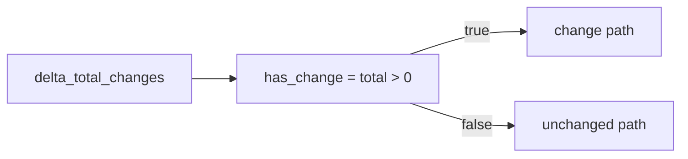

# 2026-10-31: Stage 1717 — Source monitor gate_health blocking-reasons delta has-change telemetry

[中文](2026-10-31-source-monitor-gate-health-blocking-reasons-delta-has-change.md) | [Stage archive index](../stage-archive-index.md)

## Background and objective

Stage 1716 already introduced `blocking_reasons_delta_net_change_magnitude` as a magnitude signal.  
When downstream consumers only need a yes/no change gate, they still have to derive `magnitude > 0`.

Stage 1717 adds `blocking_reasons_delta_has_change` as a direct boolean change signal.

## Implementation

### `scripts/source_monitor.py`

- Added field:
  - `gate_health.blocking_reasons_delta_has_change`
- Semantics:
  - emits `null` when no prior reasons exist (`previous_blocking_reasons is None`);
  - with prior reasons, emits boolean `blocking_reasons_delta_total_changes > 0`.

### `tests/test_source_monitor.py`

- Baseline assertion: `blocking_reasons_delta_has_change is None`;
- Changed assertion: `blocking_reasons_delta_has_change is True`;
- Unchanged assertion: `blocking_reasons_delta_has_change is False`;
- Remaining regression remains green.

## Visual map (boolean short-circuit)



## Validation

Executed during the user-authorized daytime window:

```bash
python -m pytest tests/test_source_monitor.py -q
python -m pytest -q
python scripts/source_monitor.py --registry research/sources.json --output-dir research/daily
```

Results:
- `tests/test_source_monitor.py`: `43 passed, 6 subtests passed`;
- full regression: `4267 passed, 1089 subtests passed`;
- refreshed `research/daily/2026-10-31-sources.json` now includes
  `gate_health.blocking_reasons_delta_has_change` (current baseline run: `null`).

## Architecture impact

1. **Lower consumer logic cost:** downstream rules can branch on one boolean without re-deriving expressions.  
2. **Clearer signal layering:** direction, magnitude, and changed/not-changed remain separable for policy composition.  
3. **Boundary unchanged:** still public-source retrieval and offline aggregation, with no payment execution or account authority.
