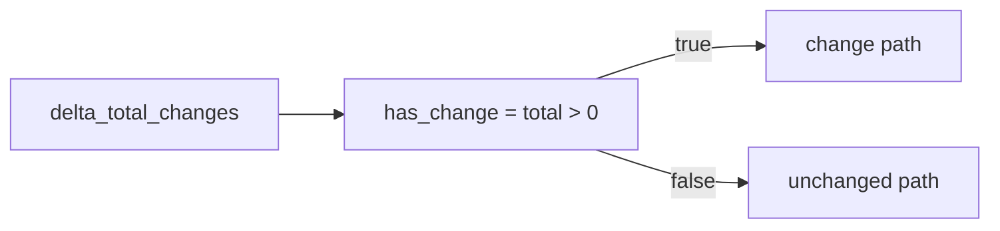

# 2026-10-31：Stage 1717 —— source-monitor gate_health 阻塞原因增量变化布尔信号

[English](2026-10-31-source-monitor-gate-health-blocking-reasons-delta-has-change.en.md) | [阶段索引](../stage-archive-index.md)

## 背景与目标

Stage 1716 已提供 `blocking_reasons_delta_net_change_magnitude` 幅度信号。  
当下游仅需要“是否发生变化”的布尔判断时，仍需自行写 `magnitude > 0` 逻辑。

Stage 1717 新增 `blocking_reasons_delta_has_change`，直接输出变化布尔值。

## 实现

### `scripts/source_monitor.py`

- 新增字段：
  - `gate_health.blocking_reasons_delta_has_change`
- 语义：
  - 若无前态原因（`previous_blocking_reasons is None`），输出 `null`；
  - 若有前态原因，输出 `blocking_reasons_delta_total_changes > 0` 的布尔值。

### `tests/test_source_monitor.py`

- baseline 场景断言 `blocking_reasons_delta_has_change is None`；
- changed 场景断言 `blocking_reasons_delta_has_change is True`；
- unchanged 场景断言 `blocking_reasons_delta_has_change is False`；
- 其余回归保持通过。

## 图示（变化布尔短路）



## 验证

北京时间白天授权窗口内执行：

```bash
python -m pytest tests/test_source_monitor.py -q
python -m pytest -q
python scripts/source_monitor.py --registry research/sources.json --output-dir research/daily
```

结果：
- `tests/test_source_monitor.py`：`43 passed, 6 subtests passed`；
- 全量回归：`4267 passed, 1089 subtests passed`；
- 刷新后的 `research/daily/2026-10-31-sources.json` 已包含
  `gate_health.blocking_reasons_delta_has_change`（当前 baseline run 为 `null`）。

## 架构影响

1. **最小化消费端逻辑**：下游可直接读取布尔位触发变化分支，无需重复表达式。  
2. **语义层次更清晰**：方向、幅度、是否变化三类信号分离，便于策略组合。  
3. **边界不变**：仍为公开来源抓取与离线聚合，不涉及支付执行或账户权限。
