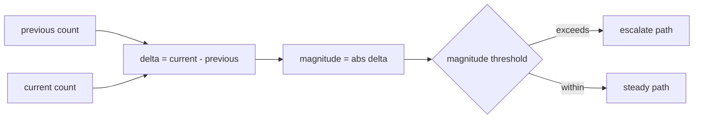

# 2026-10-31: Stage 1716 — Source monitor gate_health blocking-reasons delta net-change-magnitude telemetry

[中文](2026-10-31-source-monitor-gate-health-blocking-reasons-delta-net-change-magnitude.md) | [Stage archive index](../stage-archive-index.md)

## Background and objective

Stage 1715 already introduced `blocking_reasons_delta_net_change` as a signed net-change value.  
When downstream systems only care whether change magnitude exceeds a threshold, they still need to apply `abs(...)` themselves.

Stage 1716 adds `blocking_reasons_delta_net_change_magnitude` as a direct absolute net-change signal.

## Implementation

### `scripts/source_monitor.py`

- Added field:
  - `gate_health.blocking_reasons_delta_net_change_magnitude`
- Semantics:
  - emits `null` when no prior reasons exist (`previous_blocking_reasons is None`);
  - with prior reasons, emits
    `abs(len(current_blocking_reasons) - len(previous_blocking_reasons))`.

### `tests/test_source_monitor.py`

- Baseline assertion: `blocking_reasons_delta_net_change_magnitude is None`;
- Changed assertion: absolute net change is `1`;
- Unchanged assertion: absolute net change is `0`;
- Remaining regression remains green.

## Visual map (absolute change magnitude)



## Validation

Executed during the user-authorized daytime window:

```bash
python -m pytest tests/test_source_monitor.py -q
python -m pytest -q
python scripts/source_monitor.py --registry research/sources.json --output-dir research/daily
```

Results:
- `tests/test_source_monitor.py`: `43 passed, 6 subtests passed`;
- full regression: `4267 passed, 1089 subtests passed`;
- refreshed `research/daily/2026-10-31-sources.json` now includes
  `gate_health.blocking_reasons_delta_net_change_magnitude` (current baseline run: `null`).

## Architecture impact

1. **Unified threshold stratification:** consumers can apply one unsigned-threshold policy directly.  
2. **Cleaner routing responsibilities:** direction comes from `..._direction`, magnitude from `..._magnitude`, avoiding mixed semantics.  
3. **Boundary unchanged:** still public-source retrieval and offline aggregation, with no payment execution or account authority.
