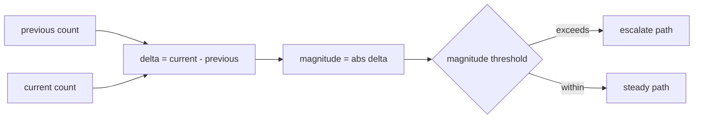

# 2026-10-31：Stage 1716 —— source-monitor gate_health 阻塞原因增量净变化绝对值信号

[English](2026-10-31-source-monitor-gate-health-blocking-reasons-delta-net-change-magnitude.en.md) | [阶段索引](../stage-archive-index.md)

## 背景与目标

Stage 1715 已提供 `blocking_reasons_delta_net_change` 有符号净变化值。  
当下游仅关注“变化幅度是否超过阈值”而不关心方向时，仍需自行取绝对值。

Stage 1716 新增 `blocking_reasons_delta_net_change_magnitude`，直接输出净变化绝对值。

## 实现

### `scripts/source_monitor.py`

- 新增字段：
  - `gate_health.blocking_reasons_delta_net_change_magnitude`
- 语义：
  - 若无前态原因（`previous_blocking_reasons is None`），输出 `null`；
  - 若有前态原因，输出
    `abs(len(current_blocking_reasons) - len(previous_blocking_reasons))`。

### `tests/test_source_monitor.py`

- baseline 场景断言 `blocking_reasons_delta_net_change_magnitude is None`；
- changed 场景断言净变化绝对值为 `1`；
- unchanged 场景断言净变化绝对值为 `0`；
- 其余回归保持通过。

## 图示（绝对值变化幅度）



## 验证

北京时间白天授权窗口内执行：

```bash
python -m pytest tests/test_source_monitor.py -q
python -m pytest -q
python scripts/source_monitor.py --registry research/sources.json --output-dir research/daily
```

结果：
- `tests/test_source_monitor.py`：`43 passed, 6 subtests passed`；
- 全量回归：`4267 passed, 1089 subtests passed`；
- 刷新后的 `research/daily/2026-10-31-sources.json` 已包含
  `gate_health.blocking_reasons_delta_net_change_magnitude`（当前 baseline run 为 `null`）。

## 架构影响

1. **阈值分层更统一**：消费端可按无符号幅度直接做统一阈值判断。  
2. **路由分工更清晰**：方向由 `..._direction` 提供，幅度由 `..._magnitude` 提供，避免混用。  
3. **边界不变**：仍为公开来源抓取与离线聚合，不涉及支付执行或账户权限。
