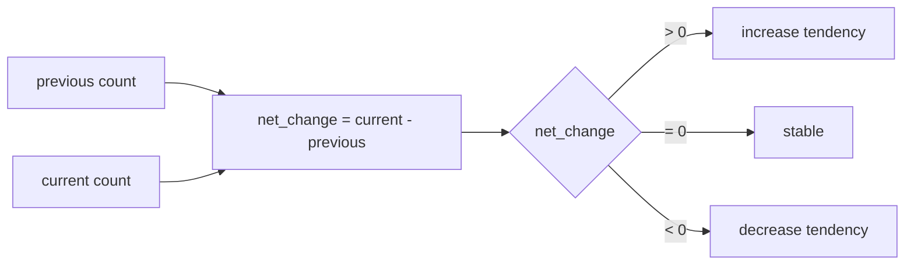

# 2026-10-31: Stage 1715 — Source monitor gate_health blocking-reasons delta net-change telemetry

[中文](2026-10-31-source-monitor-gate-health-blocking-reasons-delta-net-change.md) | [Stage archive index](../stage-archive-index.md)

## Background and objective

Stage 1714 already provides `blocking_reasons_delta_direction` enum semantics.  
Downstream systems still had to derive signed net-change thresholds themselves (for example, escalate only when net change > 1).

Stage 1715 adds `blocking_reasons_delta_net_change` as a direct signed net-change value.

## Implementation

### `scripts/source_monitor.py`

- Added field:
  - `gate_health.blocking_reasons_delta_net_change`
- Semantics:
  - emits `null` when no prior reasons exist (`previous_blocking_reasons is None`);
  - with prior reasons, emits `len(current_blocking_reasons) - len(previous_blocking_reasons)`.

### `tests/test_source_monitor.py`

- Baseline assertion: `blocking_reasons_delta_net_change is None`;
- Changed assertion: net change is `1`;
- Unchanged assertion: net change is `0`;
- Remaining regression remains green.

## Visual map (net-change derivation)



## Validation

Executed during the user-authorized daytime window:

```bash
python -m pytest tests/test_source_monitor.py -q
python -m pytest -q
python scripts/source_monitor.py --registry research/sources.json --output-dir research/daily
```

Results:
- `tests/test_source_monitor.py`: `43 passed, 6 subtests passed`;
- full regression: `4267 passed, 1089 subtests passed`;
- refreshed `research/daily/2026-10-31-sources.json` now includes
  `gate_health.blocking_reasons_delta_net_change` (current baseline run: `null`).

## Architecture impact

1. **Direct threshold routing:** downstream systems can route on signed net-change values without recomputation.  
2. **Lower aggregation overhead:** consumers no longer need to re-derive `current-previous` in every pipeline.  
3. **Boundary unchanged:** still public-source retrieval and offline aggregation, with no payment execution or account authority.
