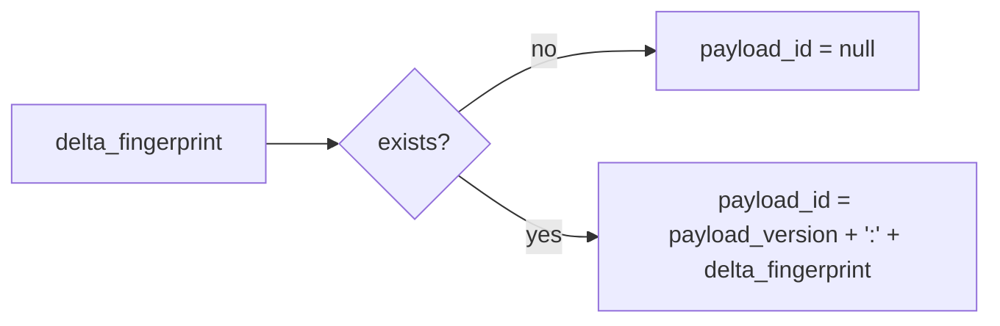

# 2026-10-31: Stage 1711 — Source monitor gate_health blocking-reasons delta payload-id telemetry

[中文](2026-10-31-source-monitor-gate-health-blocking-reasons-delta-payload-id.md) | [Stage archive index](../stage-archive-index.md)

## Background and objective

Stage 1710 already emits `blocking_reasons_delta_payload_version` and `blocking_reasons_delta_payload`.  
Downstream systems still had to concatenate version and delta fingerprint themselves for idempotent routing and indexing.

Stage 1711 adds `blocking_reasons_delta_payload_id` as a direct version-prefixed single-value identifier.

## Implementation

### `scripts/source_monitor.py`

- Added field:
  - `gate_health.blocking_reasons_delta_payload_id`
- Semantics:
  - emits `null` when `blocking_reasons_delta_fingerprint is None`;
  - otherwise emits:
    - `${blocking_reasons_delta_payload_version}:${blocking_reasons_delta_fingerprint}`
  - co-located with payload version and payload for an “ID + version + payload” contract.

### `tests/test_source_monitor.py`

- Baseline assertion: `blocking_reasons_delta_payload_id is None`;
- Changed/unchanged assertions:
  - `blocking_reasons_delta_payload_id` equals
    `${BLOCKING_REASONS_DELTA_PAYLOAD_VERSION}:${blocking_reasons_delta_fingerprint}`;
- Added `test_blocking_reasons_delta_payload_id_prefixes_version` to verify stable version-prefixed ID shape.

## Visual map (payload ID derivation)



## Validation

Executed during the user-authorized daytime window:

```bash
python -m pytest tests/test_source_monitor.py -q
python -m pytest -q
python scripts/source_monitor.py --registry research/sources.json --output-dir research/daily
```

Results:
- `tests/test_source_monitor.py`: `43 passed, 6 subtests passed`;
- full regression: `4267 passed, 1089 subtests passed`;
- refreshed `research/daily/2026-10-31-sources.json` now includes:
  - `gate_health.blocking_reasons_delta_payload_id` (current baseline run: `null`).

## Architecture impact

1. **Single-value idempotency key:** downstream systems can deduplicate and route without rebuilding IDs from multiple fields.  
2. **Index consistency:** a canonical ID format reduces cross-service encoding divergence for the same reason-delta event.  
3. **Boundary unchanged:** still public-source retrieval and offline aggregation, with no payment execution or account authority.
