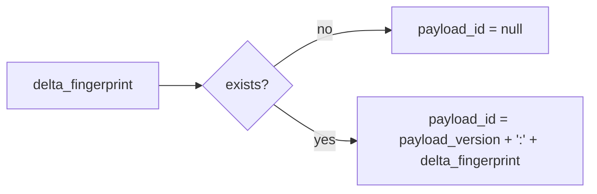

# 2026-10-31：Stage 1711 —— source-monitor gate_health 阻塞原因增量载荷 ID 信号

[English](2026-10-31-source-monitor-gate-health-blocking-reasons-delta-payload-id.en.md) | [阶段索引](../stage-archive-index.md)

## 背景与目标

Stage 1710 已输出 `blocking_reasons_delta_payload_version` 与 `blocking_reasons_delta_payload`。  
下游若要做幂等去重和索引路由，仍需自行拼接版本号与增量指纹。

Stage 1711 新增 `blocking_reasons_delta_payload_id`，直接提供版本前缀化单值 ID。

## 实现

### `scripts/source_monitor.py`

- 新增字段：
  - `gate_health.blocking_reasons_delta_payload_id`
- 语义：
  - 若 `blocking_reasons_delta_fingerprint is None`，输出 `null`；
  - 否则输出：
    - `${blocking_reasons_delta_payload_version}:${blocking_reasons_delta_fingerprint}`
  - 与 `payload_version`、`payload` 同位输出，形成“ID + 版本 + 载荷”三联契约。

### `tests/test_source_monitor.py`

- baseline 场景断言 `blocking_reasons_delta_payload_id is None`；
- changed/unchanged 场景断言：
  - `blocking_reasons_delta_payload_id` 等于
    `${BLOCKING_REASONS_DELTA_PAYLOAD_VERSION}:${blocking_reasons_delta_fingerprint}`；
- 新增 `test_blocking_reasons_delta_payload_id_prefixes_version`，
  校验 payload ID 的版本前缀稳定。

## 图示（载荷 ID 生成）



## 验证

北京时间白天授权窗口内执行：

```bash
python -m pytest tests/test_source_monitor.py -q
python -m pytest -q
python scripts/source_monitor.py --registry research/sources.json --output-dir research/daily
```

结果：
- `tests/test_source_monitor.py`：`43 passed, 6 subtests passed`；
- 全量回归：`4267 passed, 1089 subtests passed`；
- 刷新后的 `research/daily/2026-10-31-sources.json` 已包含：
  - `gate_health.blocking_reasons_delta_payload_id`（当前 baseline run 为 `null`）。

## 架构影响

1. **单值幂等键可直接消费**：下游无需自行拼接版本与指纹即可做去重和路由。  
2. **索引一致性提升**：统一 ID 形态减少跨服务对同一增量事件的编码差异。  
3. **边界不变**：仍为公开来源抓取与离线聚合，不涉及支付执行或账户权限。
