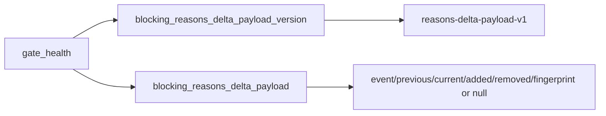

# 2026-10-31: Stage 1710 — Source monitor gate_health blocking-reasons delta payload-version telemetry

[中文](2026-10-31-source-monitor-gate-health-blocking-reasons-delta-payload-version.md) | [Stage archive index](../stage-archive-index.md)

## Background and objective

Stage 1709 added `blocking_reasons_delta_payload` for single-read reason-delta evidence.  
Downstream consumers still need an explicit version anchor to bind parser logic and avoid silent compatibility drift when payload fields evolve.

Stage 1710 adds `blocking_reasons_delta_payload_version`, emitted alongside the payload as a fixed contract marker.

## Implementation

### `scripts/source_monitor.py`

- Added constant:
  - `BLOCKING_REASONS_DELTA_PAYLOAD_VERSION = "reasons-delta-payload-v1"`
- Added field:
  - `gate_health.blocking_reasons_delta_payload_version`
- Semantics:
  - emits a fixed version value regardless of prior-state availability;
  - pairs with `blocking_reasons_delta_payload` to provide a stable “version + payload” contract.

### `tests/test_source_monitor.py`

- Baseline/changed/unchanged scenarios now all assert:
  - `blocking_reasons_delta_payload_version == BLOCKING_REASONS_DELTA_PAYLOAD_VERSION`
- Added stability test:
  - `test_blocking_reasons_delta_payload_version_is_stable`

## Visual map (versioned payload contract)



## Validation

Executed during the user-authorized daytime window:

```bash
python -m pytest tests/test_source_monitor.py -q
python -m pytest -q
python scripts/source_monitor.py --registry research/sources.json --output-dir research/daily
```

Results:
- `tests/test_source_monitor.py`: `42 passed, 6 subtests passed`;
- full regression: `4266 passed, 1089 subtests passed`;
- refreshed `research/daily/2026-10-31-sources.json` now includes:
  - `gate_health.blocking_reasons_delta_payload_version = "reasons-delta-payload-v1"`
  - `gate_health.blocking_reasons_delta_payload` (current baseline run: `null`).

## Architecture impact

1. **Explicit contract anchor:** reason-delta payload consumers can bind logic to a dedicated version field.  
2. **Controlled evolution:** payload shape can evolve with versioned compatibility instead of implicit breakage.  
3. **Boundary unchanged:** still public-source retrieval and offline aggregation, with no payment execution or account authority.
