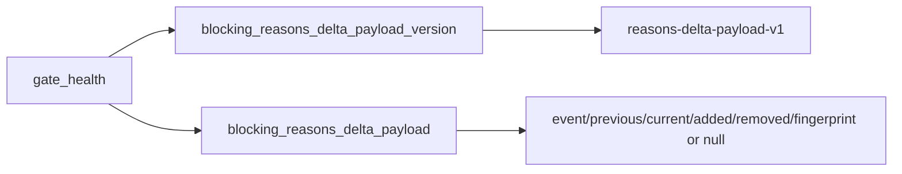

# 2026-10-31：Stage 1710 —— source-monitor gate_health 阻塞原因增量载荷版本信号

[English](2026-10-31-source-monitor-gate-health-blocking-reasons-delta-payload-version.en.md) | [阶段索引](../stage-archive-index.md)

## 背景与目标

Stage 1709 已提供 `blocking_reasons_delta_payload`，可一次输出阻塞原因增量证据。  
下游消费端仍需要一个显式版本字段来绑定解析契约，避免未来字段演进时的静默兼容风险。

Stage 1710 新增 `blocking_reasons_delta_payload_version`，固定版本号并与 payload 同位输出。

## 实现

### `scripts/source_monitor.py`

- 新增常量：
  - `BLOCKING_REASONS_DELTA_PAYLOAD_VERSION = "reasons-delta-payload-v1"`
- 新增字段：
  - `gate_health.blocking_reasons_delta_payload_version`
- 语义：
  - 无论是否存在前态原因，始终输出固定版本号；
  - 与 `blocking_reasons_delta_payload` 配对，形成“版本 + 载荷”稳定消费契约。

### `tests/test_source_monitor.py`

- baseline/changed/unchanged 三类场景均断言：
  - `blocking_reasons_delta_payload_version == BLOCKING_REASONS_DELTA_PAYLOAD_VERSION`
- 新增版本稳定性测试：
  - `test_blocking_reasons_delta_payload_version_is_stable`

## 图示（版本化载荷契约）



## 验证

北京时间白天授权窗口内执行：

```bash
python -m pytest tests/test_source_monitor.py -q
python -m pytest -q
python scripts/source_monitor.py --registry research/sources.json --output-dir research/daily
```

结果：
- `tests/test_source_monitor.py`：`42 passed, 6 subtests passed`；
- 全量回归：`4266 passed, 1089 subtests passed`；
- 刷新后的 `research/daily/2026-10-31-sources.json` 已包含：
  - `gate_health.blocking_reasons_delta_payload_version = "reasons-delta-payload-v1"`
  - `gate_health.blocking_reasons_delta_payload`（当前 baseline run 为 `null`）。

## 架构影响

1. **契约显式化**：阻塞原因增量载荷具备独立版本锚点，降低下游静默兼容风险。  
2. **演进可控**：未来可通过版本并行演进载荷结构，避免破坏现有消费端。  
3. **边界不变**：仍为公开来源抓取与离线聚合，不涉及支付执行或账户权限。
