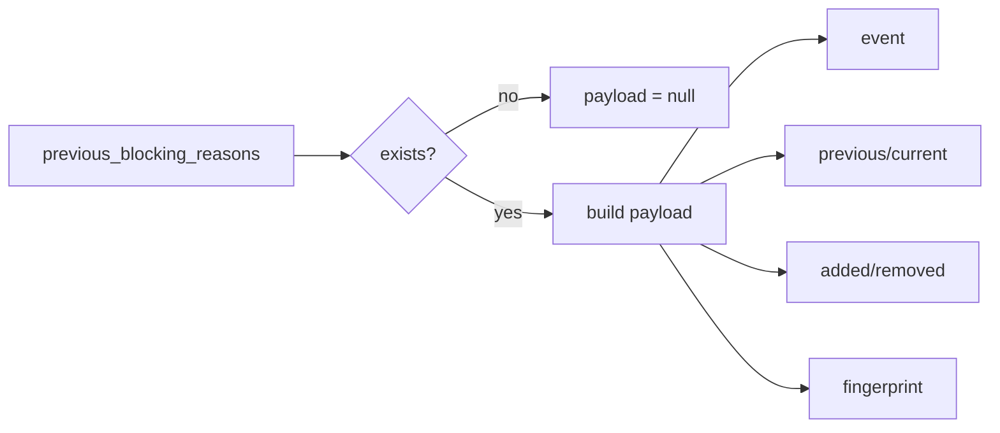

# 2026-10-31: Stage 1709 — Source monitor gate_health blocking-reasons delta payload telemetry

[中文](2026-10-31-source-monitor-gate-health-blocking-reasons-delta-payload.md) | [Stage archive index](../stage-archive-index.md)

## Background and objective

Stage 1708 already provides a tri-state `blocking_reasons_delta_event` bit.  
For full evidence consumption, downstream systems still needed to join multiple fields
(`previous/current/added/removed/fingerprint`) across the gate payload.

Stage 1709 adds single-object `blocking_reasons_delta_payload` so reason-delta evidence is emitted in one read.

## Implementation

### `scripts/source_monitor.py`

- Added field:
  - `gate_health.blocking_reasons_delta_payload`
- Semantics:
  - if no prior reasons exist (`previous_blocking_reasons is None`), emits `null`;
  - if prior reasons exist, emits:
    - `event`: `blocking_reasons_delta_event`
    - `previous`: prior blocking reasons
    - `current`: current blocking reasons
    - `added`: added reasons
    - `removed`: removed reasons
    - `fingerprint`: `blocking_reasons_delta_fingerprint`

### `tests/test_source_monitor.py`

- Baseline assertion: `blocking_reasons_delta_payload is None`;
- Changed assertion: payload includes `event=True`, expected `added/removed`, and matching fingerprint;
- Unchanged assertion: payload includes `event=False` with empty `added/removed`;
- Remaining regression stays green.

## Visual map (blocking-reasons delta payload)



## Validation

Executed during the user-authorized daytime window:

```bash
python -m pytest tests/test_source_monitor.py -q
python -m pytest -q
python scripts/source_monitor.py --registry research/sources.json --output-dir research/daily
```

Results:
- `tests/test_source_monitor.py`: `41 passed, 6 subtests passed`;
- full regression: `4265 passed, 1089 subtests passed`;
- refreshed `research/daily/2026-10-31-sources.json` now includes
  `gate_health.blocking_reasons_delta_payload` (current baseline run: `null`).

## Architecture impact

1. **Single-read evidence consumption:** downstream systems can consume full reason-delta evidence from one object, reducing cross-field joins and mismatch risk.  
2. **Joint event + dedup consumption:** `event` and `fingerprint` are co-located for routing and idempotent processing.  
3. **Boundary unchanged:** still public-source retrieval and offline aggregation, with no payment execution or account authority.
