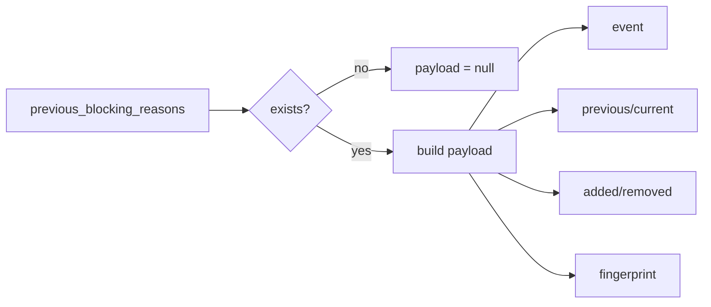

# 2026-10-31：Stage 1709 —— source-monitor gate_health 阻塞原因增量载荷信号

[English](2026-10-31-source-monitor-gate-health-blocking-reasons-delta-payload.en.md) | [阶段索引](../stage-archive-index.md)

## 背景与目标

Stage 1708 已提供 `blocking_reasons_delta_event` 三态事件位。  
下游消费端若要拿到完整证据，仍需额外拼装 `previous/current/added/removed/fingerprint` 多个字段。

Stage 1709 新增单字段对象 `blocking_reasons_delta_payload`，将阻塞原因增量证据一次聚合输出。

## 实现

### `scripts/source_monitor.py`

- 新增字段：
  - `gate_health.blocking_reasons_delta_payload`
- 语义：
  - 若无前态原因（`previous_blocking_reasons is None`），输出 `null`；
  - 若存在前态原因，输出对象：
    - `event`：`blocking_reasons_delta_event`
    - `previous`：前态阻塞原因列表
    - `current`：当前阻塞原因列表
    - `added`：新增原因列表
    - `removed`：移除原因列表
    - `fingerprint`：`blocking_reasons_delta_fingerprint`

### `tests/test_source_monitor.py`

- baseline 场景断言 `blocking_reasons_delta_payload is None`；
- changed 场景断言 payload 含 `event=True`、正确 `added/removed` 与指纹映射；
- unchanged 场景断言 payload 含 `event=False`，且 `added/removed` 为空；
- 其余回归保持通过。

## 图示（阻塞原因增量载荷）



## 验证

北京时间白天授权窗口内执行：

```bash
python -m pytest tests/test_source_monitor.py -q
python -m pytest -q
python scripts/source_monitor.py --registry research/sources.json --output-dir research/daily
```

结果：
- `tests/test_source_monitor.py`：`41 passed, 6 subtests passed`；
- 全量回归：`4265 passed, 1089 subtests passed`；
- 刷新后的 `research/daily/2026-10-31-sources.json` 已包含
  `gate_health.blocking_reasons_delta_payload`（当前 baseline run 为 `null`）。

## 架构影响

1. **单字段证据读取**：下游可通过一个对象读取原因增量全量证据，减少跨字段拼装与漏读风险。  
2. **事件与去重联合消费**：`event` 与 `fingerprint` 同位输出，便于路由和幂等去重协同。  
3. **边界不变**：仍是公开来源抓取与离线聚合，不涉及支付执行或账户权限。
