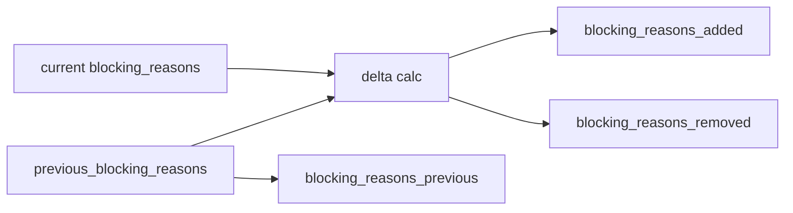

# 2026-10-31: Stage 1706 — Source monitor gate_health blocking-reasons delta telemetry

[中文](2026-10-31-source-monitor-gate-health-blocking-reasons-delta.md) | [Stage archive index](../stage-archive-index.md)

## Background and objective

Stage 1705 already provided transition event payload and payload versioning.  
Downstream systems still need a direct answer to “which blocking reasons were added or removed vs prior state” without reconstructing cross-snapshot diffs themselves.

Stage 1706 adds `blocking_reasons_previous/added/removed`.

## Implementation

### `scripts/source_monitor.py`

- `previous_blocking_state_snapshot(...)` now recovers prior `blocking_reasons` when available.
- `summarize_gate_health(...)` adds parameter:
  - `previous_blocking_reasons`
- Added output fields:
  - `gate_health.blocking_reasons_previous`
  - `gate_health.blocking_reasons_added`
  - `gate_health.blocking_reasons_removed`
- Semantics:
  - when no prior reasons exist (`None`), all three are `null`;
  - when prior reasons exist, outputs ordered set-difference deltas.

### `tests/test_source_monitor.py`

- Added coverage for snapshot recovery of `blocking_reasons`;
- Baseline assertions verify `previous/added/removed == null`;
- Changed/unchanged assertions verify delta behavior;
- Existing regression remains green.

## Visual map (blocking-reason delta)



## Validation

Executed during the user-authorized daytime window:

```bash
python -m pytest tests/test_source_monitor.py -q
python -m pytest -q
python scripts/source_monitor.py --registry research/sources.json --output-dir research/daily
```

Results:
- `tests/test_source_monitor.py`: `40 passed, 6 subtests passed`;
- full regression: `4264 passed, 1089 subtests passed`;
- refreshed `research/daily/2026-10-31-sources.json` now includes
  `gate_health.blocking_reasons_previous/added/removed` (current baseline run: `null`).

## Architecture impact

1. **Incremental alerting is simpler:** downstream systems can consume reason deltas directly without recomputing set differences from historical snapshots.  
2. **Audit semantics are clearer:** blocking-reason changes can be interpreted alongside state-transition telemetry.  
3. **Boundary unchanged:** still public-source retrieval and offline aggregation, with no payment execution or account authority.
