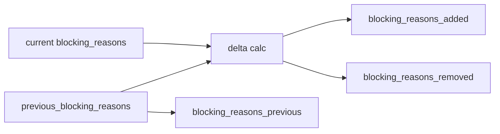

# 2026-10-31：Stage 1706 —— source-monitor gate_health 阻塞原因增量信号

[English](2026-10-31-source-monitor-gate-health-blocking-reasons-delta.en.md) | [阶段索引](../stage-archive-index.md)

## 背景与目标

Stage 1705 已提供迁移事件载荷及版本。  
下游仍需要直接知道“阻塞原因相对前态新增/移除了什么”，避免自行跨快照对比。

Stage 1706 新增阻塞原因增量信号：`blocking_reasons_previous/added/removed`。

## 实现

### `scripts/source_monitor.py`

- `previous_blocking_state_snapshot(...)` 现在在可用时回读前态 `blocking_reasons`。
- `summarize_gate_health(...)` 新增参数：
  - `previous_blocking_reasons`
- 新增输出字段：
  - `gate_health.blocking_reasons_previous`
  - `gate_health.blocking_reasons_added`
  - `gate_health.blocking_reasons_removed`
- 语义：
  - 若没有前态原因（`None`），三者均为 `null`；
  - 若有前态原因，则输出有序差集（新增/移除）。

### `tests/test_source_monitor.py`

- 新增 `previous_blocking_state_snapshot` 回读 `blocking_reasons` 的覆盖用例；
- baseline 场景断言 `previous/added/removed == null`；
- changed/unchanged 场景断言增量字段行为正确；
- 原有回归保持通过。

## 图示（阻塞原因增量）



## 验证

北京时间白天授权窗口内执行：

```bash
python -m pytest tests/test_source_monitor.py -q
python -m pytest -q
python scripts/source_monitor.py --registry research/sources.json --output-dir research/daily
```

结果：
- `tests/test_source_monitor.py`：`40 passed, 6 subtests passed`；
- 全量回归：`4264 passed, 1089 subtests passed`；
- 刷新后的 `research/daily/2026-10-31-sources.json` 已包含
  `gate_health.blocking_reasons_previous/added/removed`（当前 baseline run 为 `null`）。

## 架构影响

1. **增量告警更直接**：下游可直接消费原因增量，不再二次读历史并做集合差分。  
2. **审计语义更清晰**：阻塞原因变化与状态迁移可并行解释。  
3. **边界不变**：仍是公开来源抓取与离线聚合，不涉及支付执行或账户权限。
