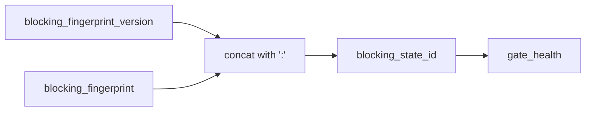

# 2026-10-31: Stage 1695 — Source monitor gate_health blocking-state-id telemetry

[中文](2026-10-31-source-monitor-gate-health-blocking-state-id.md) | [Stage archive index](../stage-archive-index.md)

## Background and objective

Stage 1694 made `blocking_fingerprint_version` explicit.  
Consumers that want single-field comparisons still had to concatenate version and fingerprint themselves.

Stage 1695 adds `blocking_state_id`, combining both parts into a stable single-field state identifier.

## Implementation

### `scripts/source_monitor.py`

- Extended `summarize_gate_health(...)` with:
  - `blocking_state_id = f"{blocking_fingerprint_version}:{blocking_fingerprint}"`
- Extended output with:
  - `gate_health.blocking_state_id`

### `tests/test_source_monitor.py`

- Failure-path assertion: `blocking_state_id` must equal `version:fingerprint`;
- Summary-path assertion: `blocking_state_id` must match expected composed value;
- Added format-stability test: `blocking_state_id` must start with `sha256-json-v1:`.

## Visual map (version-aware single-field state identifier)



## Validation

Executed during the user-authorized daytime window:

```bash
python -m unittest tests.test_source_monitor -v
python -m unittest tests.test_source_monitor tests.test_mcp_policy_facts tests.test_mcp_migration -q
python scripts/source_monitor.py
```

Results:
- `tests.test_source_monitor`: `33/33` passing;
- focused regression: `57/57` passing;
- refreshed `research/daily/2026-10-31-sources.json` now includes
  `gate_health.blocking_state_id = "sha256-json-v1:<64hex>"`.

## Architecture impact

1. **Gate-state comparison is further simplified:** consumers can compare `blocking_state_id` directly without multi-field joins.  
2. **Version awareness is now cohesive:** one field carries both digest version and digest value, reducing interpretation ambiguity.  
3. **Boundary unchanged:** still public-source retrieval and offline aggregation, with no payment execution or account authority.
