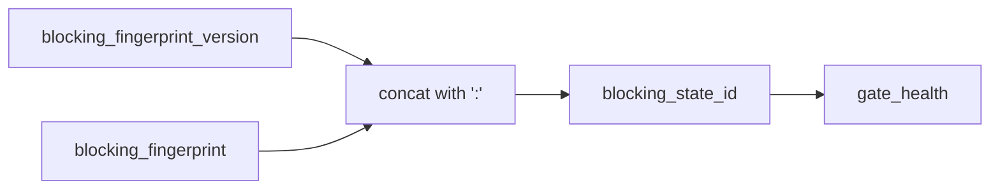

# 2026-10-31：Stage 1695 —— source-monitor gate_health 阻塞状态 ID 信号

[English](2026-10-31-source-monitor-gate-health-blocking-state-id.en.md) | [阶段索引](../stage-archive-index.md)

## 背景与目标

Stage 1694 已显式输出 `blocking_fingerprint_version`。  
但消费方若要做“单字段比较”，仍需拼接版本与指纹。

Stage 1695 新增 `blocking_state_id`，将版本与指纹组合为稳定单字段状态标识。

## 实现

### `scripts/source_monitor.py`

- 在 `summarize_gate_health(...)` 新增：
  - `blocking_state_id = f"{blocking_fingerprint_version}:{blocking_fingerprint}"`
- 返回字段新增：
  - `gate_health.blocking_state_id`

### `tests/test_source_monitor.py`

- 失败路径断言：`blocking_state_id` 必须等于 `version:fingerprint`；
- 汇总路径断言：`blocking_state_id` 与预期指纹拼接完全一致；
- 新增格式稳定性测试：`blocking_state_id` 以 `sha256-json-v1:` 为前缀。

## 图示（版本感知的单字段状态标识）



## 验证

北京时间白天授权窗口内执行：

```bash
python -m unittest tests.test_source_monitor -v
python -m unittest tests.test_source_monitor tests.test_mcp_policy_facts tests.test_mcp_migration -q
python scripts/source_monitor.py
```

结果：
- `tests.test_source_monitor`: `33/33` 通过；
- 聚焦回归：`57/57` 通过；
- 刷新后的 `research/daily/2026-10-31-sources.json` 已包含
  `gate_health.blocking_state_id = "sha256-json-v1:<64hex>"`。

## 架构影响

1. **门禁比较进一步简化**：消费方可直接比较 `blocking_state_id`，无需字段拼接。  
2. **版本感知保持内聚**：同一字段同时携带算法版本与状态指纹，降低比较语义歧义。  
3. **边界不变**：仍是公开来源抓取与离线聚合，不涉及支付执行或账户权限。
