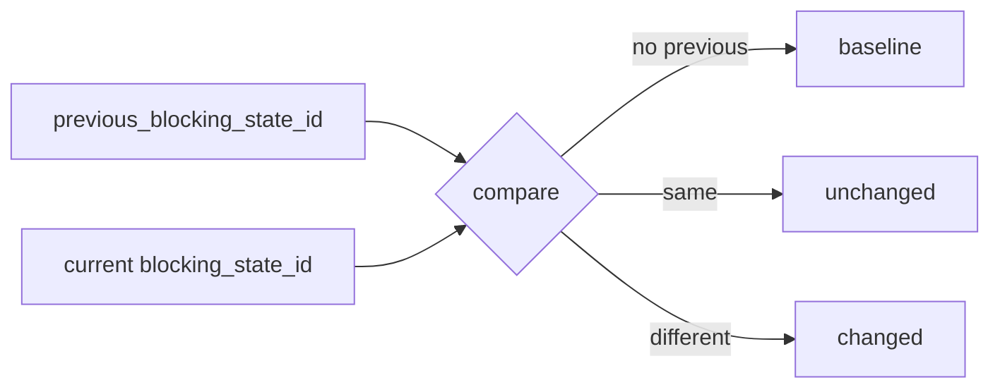

# 2026-10-31: Stage 1696 — Source monitor gate_health blocking-state transition telemetry

[中文](2026-10-31-source-monitor-gate-health-blocking-state-transition.md) | [Stage archive index](../stage-archive-index.md)

## Background and objective

Stage 1695 already provided single-field comparison via `blocking_state_id`.  
Consumers still had to fetch a prior snapshot and infer transition semantics themselves.

Stage 1696 adds explicit transition telemetry that includes prior state and transition result.

## Implementation

### `scripts/source_monitor.py`

- Added `previous_blocking_state_id(...)`:
  - reads the latest prior-daily `gate_health.blocking_state_id`.
- Extended `summarize_gate_health(...)` with a new input and outputs:
  - input: `previous_blocking_state_id`
  - outputs:
    - `gate_health.blocking_state_previous`
    - `gate_health.blocking_state_transition` (`baseline` / `unchanged` / `changed`)
- Wired prior-state lookup into `main()` before gate-health summary construction.

### `tests/test_source_monitor.py`

- Added prior-state lookup coverage;
- Added failure-path assertions for `blocking_state_previous` and `blocking_state_transition`;
- Added `unchanged`/`changed` transition assertions.

## Visual map (transition derivation)



## Validation

Executed during the user-authorized daytime window:

```bash
python -m unittest tests.test_source_monitor -v
python -m unittest tests.test_source_monitor tests.test_mcp_policy_facts tests.test_mcp_migration -q
python scripts/source_monitor.py
```

Results:
- `tests.test_source_monitor`: `35/35` passing;
- focused regression: `59/59` passing;
- refreshed `research/daily/2026-10-31-sources.json` now includes:
  - `gate_health.blocking_state_previous`
  - `gate_health.blocking_state_transition`.

## Architecture impact

1. **Transition semantics are first-class:** consumers can ingest transition state directly without cross-snapshot joins.  
2. **Drift alerting is more deterministic:** explicit `baseline/unchanged/changed` states reduce downstream interpretation variance.  
3. **Boundary unchanged:** still public-source retrieval and offline aggregation, with no payment execution or account authority.
