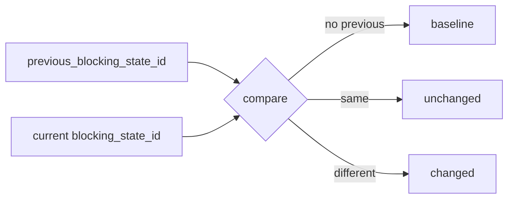

# 2026-10-31：Stage 1696 —— source-monitor gate_health 阻塞状态迁移信号

[English](2026-10-31-source-monitor-gate-health-blocking-state-transition.en.md) | [阶段索引](../stage-archive-index.md)

## 背景与目标

Stage 1695 已提供可单字段比较的 `blocking_state_id`。  
但下游仍需自行查找“前一状态”并判断是否变化。

Stage 1696 新增迁移信号，直接输出前态与迁移结论。

## 实现

### `scripts/source_monitor.py`

- 新增 `previous_blocking_state_id(...)`：
  - 从目标日期之前最近一份 daily snapshot 读取 `gate_health.blocking_state_id`。
- `summarize_gate_health(...)` 新增入参与返回字段：
  - 入参：`previous_blocking_state_id`
  - 返回：
    - `gate_health.blocking_state_previous`
    - `gate_health.blocking_state_transition`（`baseline` / `unchanged` / `changed`）
- `main()` 中将 prior state 注入 gate-health 汇总流程。

### `tests/test_source_monitor.py`

- 新增 prior-state 读取测试；
- 失败路径断言新增 `blocking_state_previous` 与 `blocking_state_transition`；
- 新增 `unchanged`/`changed` 迁移判定断言。

## 图示（状态迁移判定）



## 验证

北京时间白天授权窗口内执行：

```bash
python -m unittest tests.test_source_monitor -v
python -m unittest tests.test_source_monitor tests.test_mcp_policy_facts tests.test_mcp_migration -q
python scripts/source_monitor.py
```

结果：
- `tests.test_source_monitor`: `35/35` 通过；
- 聚焦回归：`59/59` 通过；
- 刷新后的 `research/daily/2026-10-31-sources.json` 已包含：
  - `gate_health.blocking_state_previous`
  - `gate_health.blocking_state_transition`。

## 架构影响

1. **迁移语义前置**：消费者无需再做跨快照二次比对，即可直接消费迁移结论。  
2. **漂移告警更稳定**：`baseline/unchanged/changed` 三态减少下游判定分歧。  
3. **边界不变**：仍是公开来源抓取与离线聚合，不涉及支付执行或账户权限。
