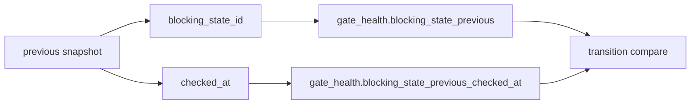

# 2026-10-31: Stage 1697 — Source monitor gate_health previous-checkpoint telemetry

[中文](2026-10-31-source-monitor-gate-health-previous-checkpoint.md) | [Stage archive index](../stage-archive-index.md)

## Background and objective

Stage 1696 introduced `blocking_state_previous` and transition semantics.  
Consumers still could not directly identify which exact prior snapshot timestamp was used.

Stage 1697 adds a prior-checkpoint timestamp anchor and emits prior `checked_at` directly.

## Implementation

### `scripts/source_monitor.py`

- Added `previous_blocking_state_snapshot(...)`:
  - extracts the latest prior daily snapshot:
    - `state_id`
    - `checked_at`
- Kept `previous_blocking_state_id(...)`, now reusing snapshot lookup logic.
- Extended `summarize_gate_health(...)` with:
  - input: `previous_blocking_checked_at`
  - output: `gate_health.blocking_state_previous_checked_at`
- Wired prior snapshot `checked_at` into `main()` gate-health assembly.

### `tests/test_source_monitor.py`

- Added snapshot-lookup coverage for `state_id + checked_at`;
- Added failure-path assertion for `blocking_state_previous_checked_at`;
- Extended `changed/unchanged` transition tests with prior-checkpoint timestamp assertions.

## Visual map (prior-checkpoint anchoring)



## Validation

Executed during the user-authorized daytime window:

```bash
python -m unittest tests.test_source_monitor -v
python -m unittest tests.test_source_monitor tests.test_mcp_policy_facts tests.test_mcp_migration -q
python scripts/source_monitor.py
```

Results:
- `tests.test_source_monitor`: `36/36` passing;
- focused regression: `60/60` passing;
- refreshed `research/daily/2026-10-31-sources.json` now includes
  `gate_health.blocking_state_previous_checked_at` (currently `null` for this run because no prior-day blocking state is available).

## Architecture impact

1. **Transition provenance is explicit:** every transition can now be tied to a concrete prior snapshot timestamp.  
2. **Audit semantics are more complete:** `state + transition + prior_checked_at` forms a closed transition evidence tuple.  
3. **Boundary unchanged:** still public-source retrieval and offline aggregation, with no payment execution or account authority.
