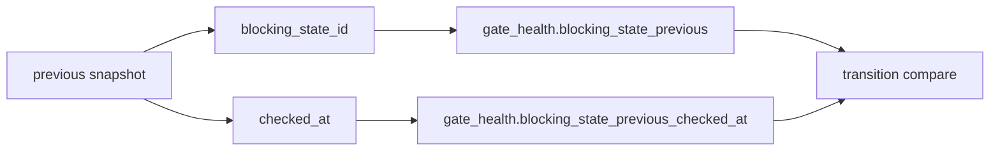

# 2026-10-31：Stage 1697 —— source-monitor gate_health 前态检查点信号

[English](2026-10-31-source-monitor-gate-health-previous-checkpoint.en.md) | [阶段索引](../stage-archive-index.md)

## 背景与目标

Stage 1696 已输出 `blocking_state_previous` 与迁移结论。  
但消费方仍无法直接知道“前态来自哪一个具体快照时间点”。

Stage 1697 新增前态检查点时间锚，直接输出前态 `checked_at`。

## 实现

### `scripts/source_monitor.py`

- 新增 `previous_blocking_state_snapshot(...)`：
  - 从目标日期之前最近一份 daily snapshot 提取：
    - `state_id`
    - `checked_at`
- 保留 `previous_blocking_state_id(...)`，改为复用 snapshot 读取逻辑。
- `summarize_gate_health(...)` 新增入参与字段：
  - 入参：`previous_blocking_checked_at`
  - 返回：`gate_health.blocking_state_previous_checked_at`
- `main()` 将 prior snapshot 的 `checked_at` 一并注入 gate-health 汇总。

### `tests/test_source_monitor.py`

- 新增 `previous_blocking_state_snapshot` 测试（校验 `state_id + checked_at`）；
- 失败路径断言新增 `blocking_state_previous_checked_at`；
- `changed/unchanged` 迁移测试补充前态时间戳断言。

## 图示（前态检查点锚定）



## 验证

北京时间白天授权窗口内执行：

```bash
python -m unittest tests.test_source_monitor -v
python -m unittest tests.test_source_monitor tests.test_mcp_policy_facts tests.test_mcp_migration -q
python scripts/source_monitor.py
```

结果：
- `tests.test_source_monitor`: `36/36` 通过；
- 聚焦回归：`60/60` 通过；
- 刷新后的 `research/daily/2026-10-31-sources.json` 已包含
  `gate_health.blocking_state_previous_checked_at` 字段（当前 run 为 `null`，表示当日之前无前态）。

## 架构影响

1. **迁移来源可追溯**：每次状态迁移判断都能定位到前态快照时间点。  
2. **审计语义更完整**：`state + transition + prior_checked_at` 构成闭环迁移证据。  
3. **边界不变**：仍是公开来源抓取与离线聚合，不涉及支付执行或账户权限。
