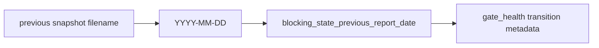

# 2026-10-31: Stage 1698 — Source monitor gate_health previous-report-date telemetry

[中文](2026-10-31-source-monitor-gate-health-previous-report-date.md) | [Stage archive index](../stage-archive-index.md)

## Background and objective

Stage 1697 already exposed prior `checked_at`.  
Some consumers route by daily-report partitions and should not reverse-derive dates from timestamps.

Stage 1698 adds a prior report-date field and emits prior source date directly as `YYYY-MM-DD`.

## Implementation

### `scripts/source_monitor.py`

- Extended `previous_blocking_state_snapshot(...)` to return:
  - `report_date = <snapshot filename[:10]>`
- Extended `summarize_gate_health(...)` with:
  - input: `previous_blocking_report_date`
  - output: `gate_health.blocking_state_previous_report_date`
- Wired prior snapshot `report_date` into `main()` gate-health summary.

### `tests/test_source_monitor.py`

- Extended prior-snapshot lookup test with `report_date` assertion;
- Added baseline assertions for `blocking_state_previous_report_date is None`;
- Extended `changed/unchanged` transition tests with prior report-date assertions.

## Visual map (prior report-date anchoring)



## Validation

Executed during the user-authorized daytime window:

```bash
python -m unittest tests.test_source_monitor -v
python -m unittest tests.test_source_monitor tests.test_mcp_policy_facts tests.test_mcp_migration -q
python scripts/source_monitor.py
```

Results:
- `tests.test_source_monitor`: `36/36` passing;
- focused regression: `60/60` passing;
- refreshed `research/daily/2026-10-31-sources.json` now includes
  `gate_health.blocking_state_previous_report_date` (currently `null` for this run because no prior-day state exists).

## Architecture impact

1. **Daily-partition routing is more direct:** consumers can join prior state by report date without timestamp parsing.  
2. **Transition metadata is more complete:** prior `state_id + checked_at + report_date` forms a readable, auditable anchor tuple.  
3. **Boundary unchanged:** still public-source retrieval and offline aggregation, with no payment execution or account authority.
