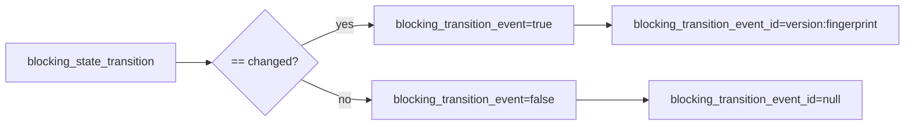

# 2026-10-31: Stage 1702 — Source monitor gate_health transition-event ID telemetry

[中文](2026-10-31-source-monitor-gate-health-transition-event-id.md) | [Stage archive index](../stage-archive-index.md)

## Background and objective

Stage 1701 added the `blocking_transition_event` boolean bit.  
Downstream deduplication and idempotent alerting usually also need a stable event ID to avoid reprocessing the same transition edge.

Stage 1702 adds `blocking_transition_event_id`, emitted only when a changed transition event occurs.

## Implementation

### `scripts/source_monitor.py`

- Extended `summarize_gate_health(...)` with:
  - `blocking_transition_event_id`
  - when `blocking_transition_event == true` and a transition fingerprint exists, emits  
    `sha256-transition-v1:<blocking_transition_fingerprint>`;
  - for baseline/unchanged transitions, emits `null`.
- Added output field:
  - `gate_health.blocking_transition_event_id`

### `tests/test_source_monitor.py`

- Baseline assertion: `blocking_transition_event_id is None`;
- Unchanged assertion: `blocking_transition_event_id is None`;
- Changed assertion: `blocking_transition_event_id == "sha256-transition-v1:<64-hex>"`.

## Visual map (event bit + event ID)



## Validation

Executed during the user-authorized daytime window:

```bash
python -m pytest tests/test_source_monitor.py -q
python -m pytest -q
python scripts/source_monitor.py --registry research/sources.json --output-dir research/daily
```

Results:
- `tests/test_source_monitor.py`: `38 passed, 6 subtests passed`;
- full regression: `4262 passed, 1089 subtests passed`;
- refreshed `research/daily/2026-10-31-sources.json` now includes
  `gate_health.blocking_transition_event_id` (current baseline run value: `null`).

## Architecture impact

1. **Idempotent consumption is simpler:** the same transition edge can be deduplicated via one stable `blocking_transition_event_id`.  
2. **Event routing is more stable:** pairing boolean trigger bit with event ID reduces downstream state composition logic.  
3. **Boundary unchanged:** still public-source retrieval and offline aggregation, with no payment execution or account authority.
