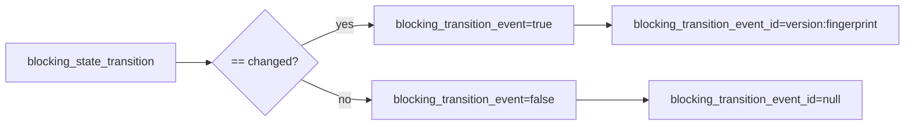

# 2026-10-31：Stage 1702 —— source-monitor gate_health 迁移事件 ID 信号

[English](2026-10-31-source-monitor-gate-health-transition-event-id.en.md) | [阶段索引](../stage-archive-index.md)

## 背景与目标

Stage 1701 已提供 `blocking_transition_event` 布尔位。  
下游去重与幂等告警通常还需要稳定事件 ID，避免重复处理同一迁移边。

Stage 1702 新增 `blocking_transition_event_id`，仅在发生 changed 迁移事件时输出稳定 ID。

## 实现

### `scripts/source_monitor.py`

- 在 `summarize_gate_health(...)` 新增：
  - `blocking_transition_event_id`
  - 当 `blocking_transition_event == true` 且存在迁移指纹时，输出  
    `sha256-transition-v1:<blocking_transition_fingerprint>`；
  - baseline/unchanged 输出 `null`。
- 返回字段新增：
  - `gate_health.blocking_transition_event_id`

### `tests/test_source_monitor.py`

- baseline 断言：`blocking_transition_event_id is None`；
- unchanged 断言：`blocking_transition_event_id is None`；
- changed 断言：`blocking_transition_event_id == "sha256-transition-v1:<64-hex>"`。

## 图示（事件位与事件 ID）



## 验证

北京时间白天授权窗口内执行：

```bash
python -m pytest tests/test_source_monitor.py -q
python -m pytest -q
python scripts/source_monitor.py --registry research/sources.json --output-dir research/daily
```

结果：
- `tests/test_source_monitor.py`：`38 passed, 6 subtests passed`；
- 全量回归：`4262 passed, 1089 subtests passed`；
- 刷新后的 `research/daily/2026-10-31-sources.json` 已包含
  `gate_health.blocking_transition_event_id`（当前 baseline run 为 `null`）。

## 架构影响

1. **幂等消费更直接**：同一迁移边可由 `blocking_transition_event_id` 单值去重。  
2. **事件路由更稳定**：布尔触发位与事件 ID 配合，减少下游状态拼装。  
3. **边界不变**：仍是公开来源抓取与离线聚合，不涉及支付执行或账户权限。
