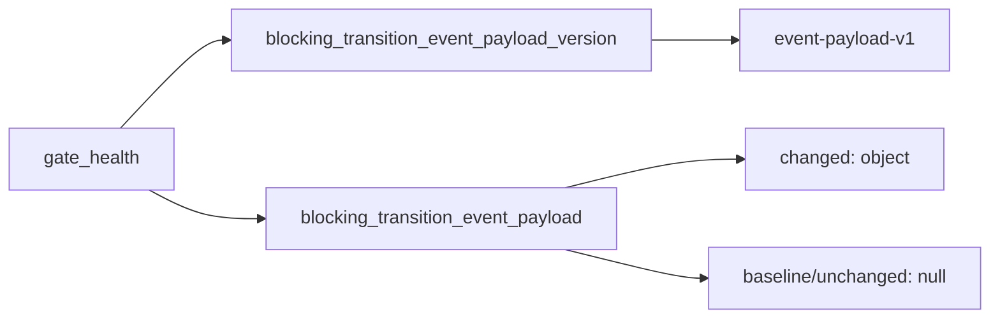

# 2026-10-31: Stage 1705 — Source monitor gate_health transition event-payload version telemetry

[中文](2026-10-31-source-monitor-gate-health-transition-event-payload-version.md) | [Stage archive index](../stage-archive-index.md)

## Background and objective

Stage 1704 introduced `blocking_transition_event_payload`.  
Downstream consumers need an explicit version anchor so future payload-shape evolution does not silently drift parser behavior.

Stage 1705 adds `blocking_transition_event_payload_version`, fixed to `event-payload-v1`.

## Implementation

### `scripts/source_monitor.py`

- Added constant:
  - `BLOCKING_TRANSITION_EVENT_PAYLOAD_VERSION = "event-payload-v1"`
- Added `gate_health` output field:
  - `blocking_transition_event_payload_version`
- Baseline/unchanged/changed all emit the version; payload content remains controlled by
  whether `blocking_transition_event_payload` is `null`.

### `tests/test_source_monitor.py`

- Baseline/unchanged/changed assertions now verify
  `blocking_transition_event_payload_version == "event-payload-v1"`;
- Added a stability guard test to prevent accidental version drift.

## Visual map (payload version contract)



## Validation

Executed during the user-authorized daytime window:

```bash
python -m pytest tests/test_source_monitor.py -q
python -m pytest -q
python scripts/source_monitor.py --registry research/sources.json --output-dir research/daily
```

Results:
- `tests/test_source_monitor.py`: `39 passed, 6 subtests passed`;
- full regression: `4263 passed, 1089 subtests passed`;
- refreshed `research/daily/2026-10-31-sources.json` now includes
  `gate_health.blocking_transition_event_payload_version = "event-payload-v1"`.

## Architecture impact

1. **Compatibility governance is clearer:** payload consumers can bind to an explicit version contract instead of implicit field assumptions.  
2. **Evolution risk is lower:** future payload upgrades can roll out through explicit version transitions.  
3. **Boundary unchanged:** still public-source retrieval and offline aggregation, with no payment execution or account authority.
