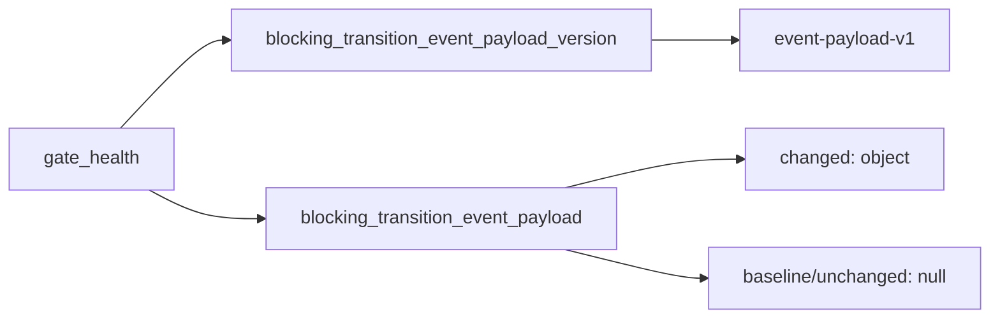

# 2026-10-31：Stage 1705 —— source-monitor gate_health 迁移事件载荷版本信号

[English](2026-10-31-source-monitor-gate-health-transition-event-payload-version.en.md) | [阶段索引](../stage-archive-index.md)

## 背景与目标

Stage 1704 已提供 `blocking_transition_event_payload`。  
下游消费者需要显式版本锚点，避免未来 payload 结构演进时出现静默解析偏差。

Stage 1705 新增 `blocking_transition_event_payload_version`，固定输出 `event-payload-v1`。

## 实现

### `scripts/source_monitor.py`

- 新增常量：
  - `BLOCKING_TRANSITION_EVENT_PAYLOAD_VERSION = "event-payload-v1"`
- 在 `gate_health` 输出新增：
  - `blocking_transition_event_payload_version`
- baseline/unchanged/changed 均输出版本号；载荷内容仍由
  `blocking_transition_event_payload` 是否为 `null` 决定。

### `tests/test_source_monitor.py`

- baseline/unchanged/changed 场景均断言
  `blocking_transition_event_payload_version == "event-payload-v1"`；
- 新增稳定性断言测试，确保版本常量不被误改。

## 图示（载荷版本契约）



## 验证

北京时间白天授权窗口内执行：

```bash
python -m pytest tests/test_source_monitor.py -q
python -m pytest -q
python scripts/source_monitor.py --registry research/sources.json --output-dir research/daily
```

结果：
- `tests/test_source_monitor.py`：`39 passed, 6 subtests passed`；
- 全量回归：`4263 passed, 1089 subtests passed`；
- 刷新后的 `research/daily/2026-10-31-sources.json` 已包含
  `gate_health.blocking_transition_event_payload_version = "event-payload-v1"`。

## 架构影响

1. **兼容治理更明确**：payload 消费逻辑可绑定显式版本，而非隐式字段猜测。  
2. **演进风险更可控**：后续 payload 升级可通过版本切换平滑扩展。  
3. **边界不变**：仍是公开来源抓取与离线聚合，不涉及支付执行或账户权限。
