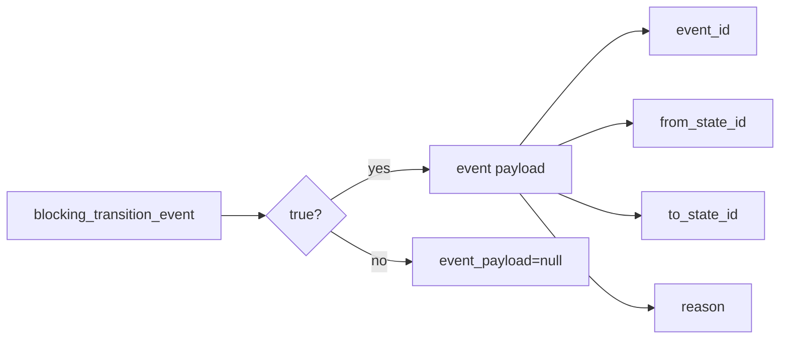

# 2026-10-31: Stage 1704 — Source monitor gate_health transition event-payload telemetry

[中文](2026-10-31-source-monitor-gate-health-transition-event-payload.md) | [Stage archive index](../stage-archive-index.md)

## Background and objective

Stage 1703 already provides `blocking_transition_event_state`.  
Downstream event buses usually also want one complete object (event ID + state pair + reason) in a single read.

Stage 1704 adds `blocking_transition_event_payload`, bundling the complete payload for changed transitions.

## Implementation

### `scripts/source_monitor.py`

- Extended `summarize_gate_health(...)` with:
  - `blocking_transition_event_payload`
  - when `blocking_transition_event == true`, emits an object with:
    - `event_id`
    - `from_state_id`
    - `to_state_id`
    - `reason`
  - for baseline/unchanged transitions, emits `null`.
- Added output field:
  - `gate_health.blocking_transition_event_payload`

### `tests/test_source_monitor.py`

- Baseline assertion: `blocking_transition_event_payload is None`;
- Unchanged assertion: `blocking_transition_event_payload is None`;
- Changed assertion: payload includes
  `event_id/from_state_id/to_state_id/reason=state_changed`.

## Visual map (transition event payload)



## Validation

Executed during the user-authorized daytime window:

```bash
python -m pytest tests/test_source_monitor.py -q
python -m pytest -q
python scripts/source_monitor.py --registry research/sources.json --output-dir research/daily
```

Results:
- `tests/test_source_monitor.py`: `38 passed, 6 subtests passed`;
- full regression: `4262 passed, 1089 subtests passed`;
- refreshed `research/daily/2026-10-31-sources.json` now includes
  `gate_health.blocking_transition_event_payload` (current baseline run value: `null`).

## Architecture impact

1. **Event-consumption interface is steadier:** downstream systems can consume a complete transition payload in one read.  
2. **Alert/audit evidence is aligned:** event ID, transition edge, and reason are bundled consistently.  
3. **Boundary unchanged:** still public-source retrieval and offline aggregation, with no payment execution or account authority.
