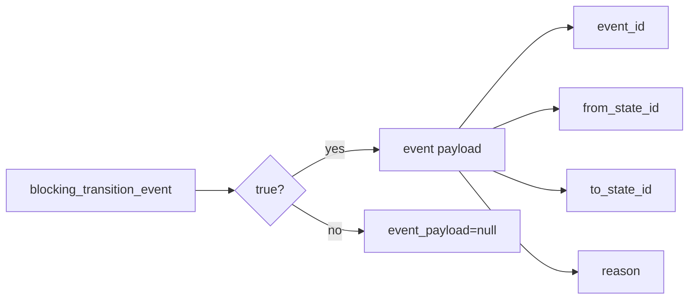

# 2026-10-31：Stage 1704 —— source-monitor gate_health 迁移事件载荷信号

[English](2026-10-31-source-monitor-gate-health-transition-event-payload.en.md) | [阶段索引](../stage-archive-index.md)

## 背景与目标

Stage 1703 已提供 `blocking_transition_event_state`。  
下游事件总线通常还希望一次读取完整事件对象（事件ID + 状态对 + 原因码）。

Stage 1704 新增 `blocking_transition_event_payload`，在 changed 迁移时聚合完整载荷。

## 实现

### `scripts/source_monitor.py`

- 在 `summarize_gate_health(...)` 新增：
  - `blocking_transition_event_payload`
  - 当 `blocking_transition_event == true` 时输出对象：
    - `event_id`
    - `from_state_id`
    - `to_state_id`
    - `reason`
  - baseline/unchanged 输出 `null`。
- 返回字段新增：
  - `gate_health.blocking_transition_event_payload`

### `tests/test_source_monitor.py`

- baseline 断言：`blocking_transition_event_payload is None`；
- unchanged 断言：`blocking_transition_event_payload is None`；
- changed 断言：`blocking_transition_event_payload` 包含
  `event_id/from_state_id/to_state_id/reason=state_changed`。

## 图示（迁移事件载荷）



## 验证

北京时间白天授权窗口内执行：

```bash
python -m pytest tests/test_source_monitor.py -q
python -m pytest -q
python scripts/source_monitor.py --registry research/sources.json --output-dir research/daily
```

结果：
- `tests/test_source_monitor.py`：`38 passed, 6 subtests passed`；
- 全量回归：`4262 passed, 1089 subtests passed`；
- 刷新后的 `research/daily/2026-10-31-sources.json` 已包含
  `gate_health.blocking_transition_event_payload`（当前 baseline run 为 `null`）。

## 架构影响

1. **事件消费接口更稳定**：下游可一次读取完整迁移事件载荷，减少拼装逻辑。  
2. **告警审计更一致**：event_id、状态边与原因在同一对象中对齐。  
3. **边界不变**：仍是公开来源抓取与离线聚合，不涉及支付执行或账户权限。
