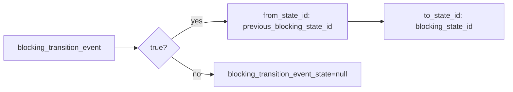

# 2026-10-31: Stage 1703 — Source monitor gate_health transition event-state telemetry

[中文](2026-10-31-source-monitor-gate-health-transition-event-state.md) | [Stage archive index](../stage-archive-index.md)

## Background and objective

Stage 1702 already provides `blocking_transition_event_id`.  
Some downstream systems also need direct from/to state-pair evidence for the transition edge, without reconstructing it across multiple fields.

Stage 1703 adds `blocking_transition_event_state`, emitted only for changed transition events.

## Implementation

### `scripts/source_monitor.py`

- Extended `summarize_gate_health(...)` with:
  - `blocking_transition_event_state`
  - when `blocking_transition_event == true`, emits:
    - `from_state_id = previous_blocking_state_id`
    - `to_state_id = blocking_state_id`
  - for baseline/unchanged transitions, emits `null`.
- Added output field:
  - `gate_health.blocking_transition_event_state`

### `tests/test_source_monitor.py`

- Baseline assertion: `blocking_transition_event_state is None`;
- Unchanged assertion: `blocking_transition_event_state is None`;
- Changed assertion: `blocking_transition_event_state == {from_state_id, to_state_id}`.

## Visual map (transition event-state pair)



## Validation

Executed during the user-authorized daytime window:

```bash
python -m pytest tests/test_source_monitor.py -q
python -m pytest -q
python scripts/source_monitor.py --registry research/sources.json --output-dir research/daily
```

Results:
- `tests/test_source_monitor.py`: `38 passed, 6 subtests passed`;
- full regression: `4262 passed, 1089 subtests passed`;
- refreshed `research/daily/2026-10-31-sources.json` now includes
  `gate_health.blocking_transition_event_state` (current baseline run value: `null`).

## Architecture impact

1. **Transition-edge consumption is simpler:** downstream systems no longer need cross-field reconstruction for from/to state IDs.  
2. **Audit context is richer:** event-triggered records can carry direct state-pair evidence.  
3. **Boundary unchanged:** still public-source retrieval and offline aggregation, with no payment execution or account authority.
