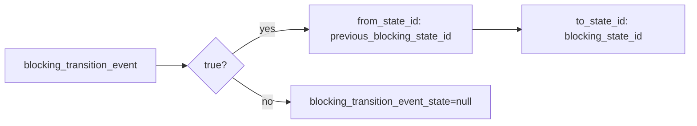

# 2026-10-31：Stage 1703 —— source-monitor gate_health 迁移事件状态对信号

[English](2026-10-31-source-monitor-gate-health-transition-event-state.en.md) | [阶段索引](../stage-archive-index.md)

## 背景与目标

Stage 1702 已提供 `blocking_transition_event_id`。  
部分下游还需要直接获得迁移边的 from/to 状态对，避免跨字段拼装。

Stage 1703 新增 `blocking_transition_event_state`，仅在 changed 迁移事件时输出状态对对象。

## 实现

### `scripts/source_monitor.py`

- 在 `summarize_gate_health(...)` 新增：
  - `blocking_transition_event_state`
  - 当 `blocking_transition_event == true` 时输出：
    - `from_state_id = previous_blocking_state_id`
    - `to_state_id = blocking_state_id`
  - baseline/unchanged 输出 `null`。
- 返回字段新增：
  - `gate_health.blocking_transition_event_state`

### `tests/test_source_monitor.py`

- baseline 断言：`blocking_transition_event_state is None`；
- unchanged 断言：`blocking_transition_event_state is None`；
- changed 断言：`blocking_transition_event_state == {from_state_id, to_state_id}`。

## 图示（迁移事件状态对）



## 验证

北京时间白天授权窗口内执行：

```bash
python -m pytest tests/test_source_monitor.py -q
python -m pytest -q
python scripts/source_monitor.py --registry research/sources.json --output-dir research/daily
```

结果：
- `tests/test_source_monitor.py`：`38 passed, 6 subtests passed`；
- 全量回归：`4262 passed, 1089 subtests passed`；
- 刷新后的 `research/daily/2026-10-31-sources.json` 已包含
  `gate_health.blocking_transition_event_state`（当前 baseline run 为 `null`）。

## 架构影响

1. **迁移边消费更直接**：下游不再需要跨字段拼装 from/to。  
2. **审计上下文更完整**：事件位触发时可直接携带状态对证据。  
3. **边界不变**：仍是公开来源抓取与离线聚合，不涉及支付执行或账户权限。
