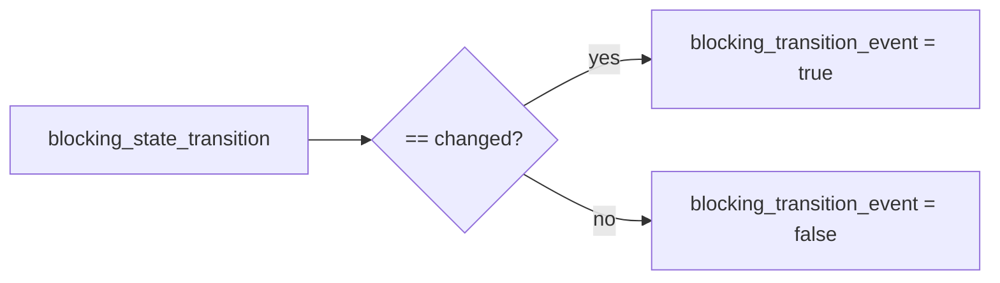

# 2026-10-31: Stage 1701 — Source monitor gate_health transition-event telemetry

[中文](2026-10-31-source-monitor-gate-health-transition-event.md) | [Stage archive index](../stage-archive-index.md)

## Background and objective

Stage 1700 already introduced transition fingerprints and reason enums.  
Some alerting systems only need a direct boolean “transition event happened” signal and should not parse strings or infer from nullable fingerprints.

Stage 1701 adds `blocking_transition_event` as a direct boolean event bit.

## Implementation

### `scripts/source_monitor.py`

- Extended `summarize_gate_health(...)` with:
  - `blocking_transition_event = (blocking_state_transition == "changed")`
- Added output field:
  - `gate_health.blocking_transition_event`

### `tests/test_source_monitor.py`

- Baseline assertion: `blocking_transition_event == False`;
- Unchanged assertion: `blocking_transition_event == False`;
- Changed assertion: `blocking_transition_event == True`.

## Visual map (transition event bit)



## Validation

Executed during the user-authorized daytime window:

```bash
python -m unittest tests.test_source_monitor -v
python -m unittest tests.test_source_monitor tests.test_mcp_policy_facts tests.test_mcp_migration -q
python scripts/source_monitor.py
```

Results:
- `tests.test_source_monitor`: `38/38` passing;
- focused regression: `62/62` passing;
- refreshed `research/daily/2026-10-31-sources.json` now includes
  `gate_health.blocking_transition_event` (current baseline run value: `false`).

## Architecture impact

1. **Alert routing is simpler:** downstream systems can trigger routing logic directly from a boolean event bit.  
2. **Consumer logic is lighter:** less string branching and null-heuristic handling.  
3. **Boundary unchanged:** still public-source retrieval and offline aggregation, with no payment execution or account authority.
