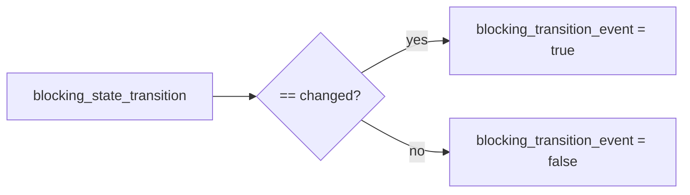

# 2026-10-31：Stage 1701 —— source-monitor gate_health 迁移事件信号

[English](2026-10-31-source-monitor-gate-health-transition-event.en.md) | [阶段索引](../stage-archive-index.md)

## 背景与目标

Stage 1700 已提供迁移指纹与原因。  
部分告警系统只需要“是否发生迁移事件”的布尔信号，不希望解析字符串或指纹是否为空。

Stage 1701 新增 `blocking_transition_event`，直接输出布尔事件位。

## 实现

### `scripts/source_monitor.py`

- 在 `summarize_gate_health(...)` 新增：
  - `blocking_transition_event = (blocking_state_transition == "changed")`
- 返回字段新增：
  - `gate_health.blocking_transition_event`

### `tests/test_source_monitor.py`

- baseline 断言：`blocking_transition_event == False`；
- unchanged 断言：`blocking_transition_event == False`；
- changed 断言：`blocking_transition_event == True`。

## 图示（迁移事件位）



## 验证

北京时间白天授权窗口内执行：

```bash
python -m unittest tests.test_source_monitor -v
python -m unittest tests.test_source_monitor tests.test_mcp_policy_facts tests.test_mcp_migration -q
python scripts/source_monitor.py
```

结果：
- `tests.test_source_monitor`: `38/38` 通过；
- 聚焦回归：`62/62` 通过；
- 刷新后的 `research/daily/2026-10-31-sources.json` 已包含
  `gate_health.blocking_transition_event`（当前 baseline run 值为 `false`）。

## 架构影响

1. **告警路由更直接**：下游可按布尔事件位直接触发策略，无需解析字符串枚举。  
2. **消费逻辑更轻量**：减少状态机分支处理与空值判断。  
3. **边界不变**：仍是公开来源抓取与离线聚合，不涉及支付执行或账户权限。
