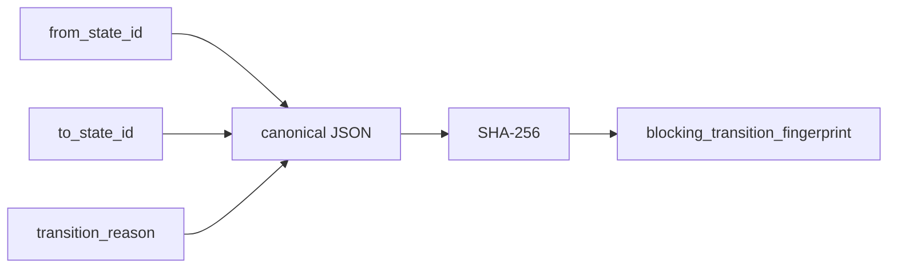

# 2026-10-31: Stage 1700 — Source monitor gate_health transition-fingerprint telemetry

[中文](2026-10-31-source-monitor-gate-health-transition-fingerprint.md) | [Stage archive index](../stage-archive-index.md)

## Background and objective

Stage 1699 already emits `blocking_state_transition_reason`.  
Consumers that deduplicate transition edges still had to compose and hash edge metadata manually.

Stage 1700 adds transition fingerprint telemetry and emits an edge-level digest directly.

## Implementation

### `scripts/source_monitor.py`

- Added constant: `BLOCKING_TRANSITION_FINGERPRINT_VERSION = "sha256-transition-v1"`.
- In `summarize_gate_health(...)`:
  - when prior state exists, compute SHA-256 over canonical JSON of
    `{from_state_id,to_state_id,transition_reason}`;
  - for baseline runs with no prior state, set `blocking_transition_fingerprint = null`.
- Added output fields:
  - `gate_health.blocking_transition_fingerprint_version`
  - `gate_health.blocking_transition_fingerprint`

### `tests/test_source_monitor.py`

- Added baseline assertions for transition-fingerprint version and `None`;
- Added changed/unchanged assertions for 64-char transition fingerprints;
- Added test ensuring reason/edge changes alter transition fingerprint;
- Added version-stability assertion.

## Visual map (edge fingerprint)



## Validation

Executed during the user-authorized daytime window:

```bash
python -m unittest tests.test_source_monitor -v
python -m unittest tests.test_source_monitor tests.test_mcp_policy_facts tests.test_mcp_migration -q
python scripts/source_monitor.py
```

Results:
- `tests.test_source_monitor`: `38/38` passing;
- focused regression: `62/62` passing;
- refreshed `research/daily/2026-10-31-sources.json` now includes:
  - `gate_health.blocking_transition_fingerprint_version = "sha256-transition-v1"`
  - `gate_health.blocking_transition_fingerprint` (currently `null` for baseline run).

## Architecture impact

1. **Edge-level transition deduplication is now first-class:** downstream systems can use transition fingerprints directly for idempotent alerting/aggregation.  
2. **Transition-event auditing is more stable:** from/to/reason evidence is compressed into one deterministic value.  
3. **Boundary unchanged:** still public-source retrieval and offline aggregation, with no payment execution or account authority.
