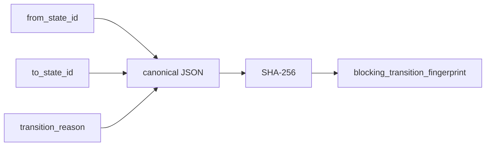

# 2026-10-31：Stage 1700 —— source-monitor gate_health 迁移指纹信号

[English](2026-10-31-source-monitor-gate-health-transition-fingerprint.en.md) | [阶段索引](../stage-archive-index.md)

## 背景与目标

Stage 1699 已有 `blocking_state_transition_reason`。  
但下游若按“迁移边（from->to）”做去重，仍需自行拼装并哈希。

Stage 1700 新增迁移指纹字段，直接给出边级唯一摘要。

## 实现

### `scripts/source_monitor.py`

- 新增常量：`BLOCKING_TRANSITION_FINGERPRINT_VERSION = "sha256-transition-v1"`。
- 在 `summarize_gate_health(...)` 中：
  - 当存在前态时，对 `{from_state_id,to_state_id,transition_reason}` 规范化 JSON 做 SHA-256；
  - 当无前态时（baseline），`blocking_transition_fingerprint = null`。
- 返回字段新增：
  - `gate_health.blocking_transition_fingerprint_version`
  - `gate_health.blocking_transition_fingerprint`

### `tests/test_source_monitor.py`

- baseline 断言新增 transition fingerprint 版本与 `None`；
- changed/unchanged 断言新增 64 位 transition fingerprint；
- 新增测试：reason 变化会导致 transition fingerprint 变化；
- 新增版本常量稳定性断言。

## 图示（迁移边指纹）



## 验证

北京时间白天授权窗口内执行：

```bash
python -m unittest tests.test_source_monitor -v
python -m unittest tests.test_source_monitor tests.test_mcp_policy_facts tests.test_mcp_migration -q
python scripts/source_monitor.py
```

结果：
- `tests.test_source_monitor`: `38/38` 通过；
- 聚焦回归：`62/62` 通过；
- 刷新后的 `research/daily/2026-10-31-sources.json` 已包含：
  - `gate_health.blocking_transition_fingerprint_version = "sha256-transition-v1"`
  - `gate_health.blocking_transition_fingerprint`（当前 baseline run 为 `null`）。

## 架构影响

1. **迁移边去重可直接消费**：下游可按 transition fingerprint 做幂等告警与聚合。  
2. **迁移事件审计更稳定**：把 from/to/reason 压缩为单值证据，降低实现分歧。  
3. **边界不变**：仍是公开来源抓取与离线聚合，不涉及支付执行或账户权限。
