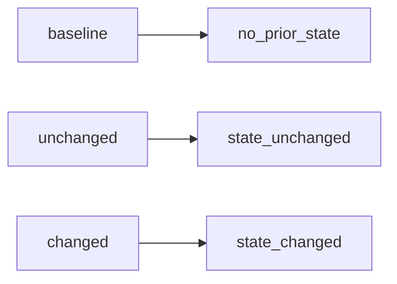

# 2026-10-31: Stage 1699 — Source monitor gate_health transition-reason telemetry

[中文](2026-10-31-source-monitor-gate-health-transition-reason.md) | [Stage archive index](../stage-archive-index.md)

## Background and objective

Since Stage 1696, `blocking_state_transition` already carries baseline/unchanged/changed.  
Some downstream consumers still want a machine-oriented reason enum without deriving semantics from transition labels.

Stage 1699 adds `blocking_state_transition_reason` as a stable reason code.

## Implementation

### `scripts/source_monitor.py`

- Refactored transition derivation in `summarize_gate_health(...)` into explicit branches:
  - `baseline` -> `no_prior_state`
  - `unchanged` -> `state_unchanged`
  - `changed` -> `state_changed`
- Added output field:
  - `gate_health.blocking_state_transition_reason`

### `tests/test_source_monitor.py`

- Added baseline assertion for `no_prior_state`;
- Added changed assertion for `state_changed`;
- Added unchanged assertion for `state_unchanged`.

## Visual map (transition-to-reason mapping)



## Validation

Executed during the user-authorized daytime window:

```bash
python -m unittest tests.test_source_monitor -v
python -m unittest tests.test_source_monitor tests.test_mcp_policy_facts tests.test_mcp_migration -q
python scripts/source_monitor.py
```

Results:
- `tests.test_source_monitor`: `36/36` passing;
- focused regression: `60/60` passing;
- refreshed `research/daily/2026-10-31-sources.json` now includes
  `gate_health.blocking_state_transition_reason` (current run value: `no_prior_state`).

## Architecture impact

1. **Transition semantics are more automatable:** downstream consumers can route directly on reason enums.  
2. **Alert interpretation is more stable:** avoids consumer-side semantic drift from ad hoc transition parsing.  
3. **Boundary unchanged:** still public-source retrieval and offline aggregation, with no payment execution or account authority.
