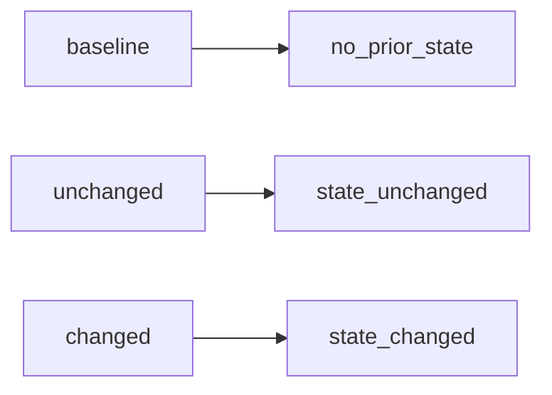

# 2026-10-31：Stage 1699 —— source-monitor gate_health 迁移原因信号

[English](2026-10-31-source-monitor-gate-health-transition-reason.en.md) | [阶段索引](../stage-archive-index.md)

## 背景与目标

Stage 1696 起已有 `blocking_state_transition` 三态。  
但部分下游希望直接消费“机器友好的原因枚举”，避免再从三态推断语义。

Stage 1699 新增 `blocking_state_transition_reason`，提供稳定原因码。

## 实现

### `scripts/source_monitor.py`

- 在 `summarize_gate_health(...)` 中将迁移判定改为显式分支：
  - `baseline` -> `no_prior_state`
  - `unchanged` -> `state_unchanged`
  - `changed` -> `state_changed`
- 返回字段新增：
  - `gate_health.blocking_state_transition_reason`

### `tests/test_source_monitor.py`

- baseline 断言新增 `no_prior_state`；
- changed 断言新增 `state_changed`；
- unchanged 断言新增 `state_unchanged`。

## 图示（迁移状态与原因映射）



## 验证

北京时间白天授权窗口内执行：

```bash
python -m unittest tests.test_source_monitor -v
python -m unittest tests.test_source_monitor tests.test_mcp_policy_facts tests.test_mcp_migration -q
python scripts/source_monitor.py
```

结果：
- `tests.test_source_monitor`: `36/36` 通过；
- 聚焦回归：`60/60` 通过；
- 刷新后的 `research/daily/2026-10-31-sources.json` 已包含
  `gate_health.blocking_state_transition_reason`（当前 run 值为 `no_prior_state`）。

## 架构影响

1. **迁移语义更可编排**：下游可直接按 reason 枚举分支路由。  
2. **告警解释更稳定**：避免消费方对三态做二次解释导致语义漂移。  
3. **边界不变**：仍是公开来源抓取与离线聚合，不涉及支付执行或账户权限。
