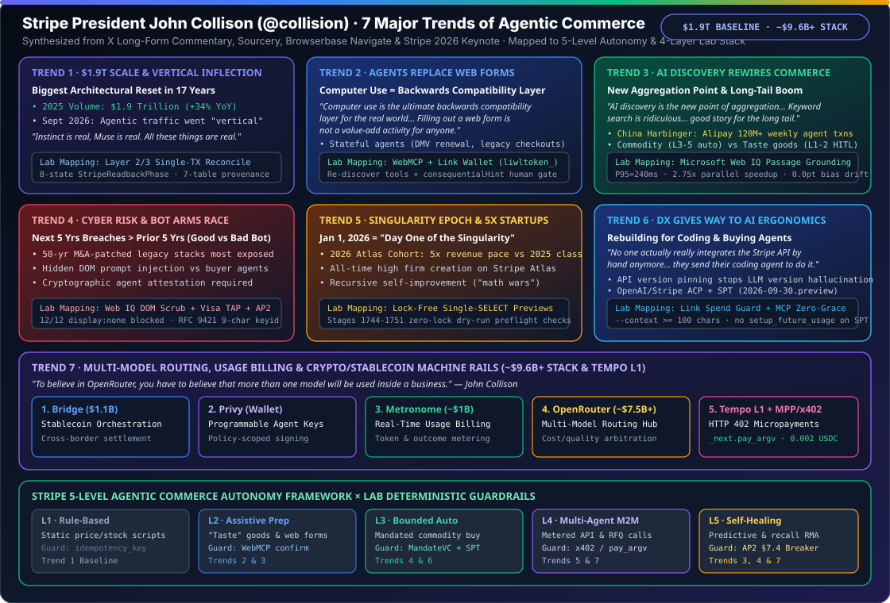

# Stripe President John Collison on the 7 Major Trends of Agentic Commerce: Deep-Dive Insights, 5-Level Autonomy Mapping & 4-Layer Architecture Alignment

> **中文对应版**: [2026-11-01-stripe-collison-7-agentic-commerce-trends.md](2026-11-01-stripe-collison-7-agentic-commerce-trends.md)  
> **Archive Date**: `2026-11-01`  
> **Primary Sources**: Stripe Co-Founder & President John Collison (@collision) — Long-form X commentary, Sourcery deep-dive interview, Browserbase Navigate fireside conversation, and Stripe 2025 Annual Letter / Stripe Sessions 2026 keynotes  
> **Repository**: [`turbo998/agentic-commerce-lab`](../../README.en.md) · [2026-11-01 Daily Report](../../research/daily/2026-11-01.en.md)

---

## 📌 Executive Summary

In late 2026, Stripe Co-Founder and President **John Collison (@collision)** laid out a comprehensive thesis on the **7 Major Structural Trends of Agentic Commerce** across his long-form X commentary, Sourcery interview, Browserbase Navigate fireside chat, and Stripe's strategic memos. Collison observes that after nearly 17 years of relative structural stability in online checkout and payment acquiring, autonomous AI agents are triggering the largest architectural reset in commerce since Stripe's founding—with real-world agentic commerce volume going **"vertical" starting in September 2026**.

This monograph synthesizes Collison's **7 major trends, verbatim quotes, and quantitative baselines**, cross-maps them against **Stripe's 5-Level Agentic Commerce Autonomy Framework (Levels 1–5)**, and translates each trend into deterministic engineering contracts within our **4-Layer Reference Architecture (`Microsoft Web IQ` live catalog grounding & DOM sanitization + `ACP/UCP` 5-state checkout FSM + `Link Agent Wallet` / `SPT` / `AP2 MandateVC` + `x402` / `MPP` / `Tempo` machine settlement rails)**.

---

## 🔭 Executive Overview: The 7 Trends of Agentic Commerce at a Glance

| Trend & Theme | Verified Quantitative Metric / Milestone | Verbatim John Collison Quotes | Core Architectural & Commercial Shift |
|---|---|---|---|
| **Trend 1: Payments Scale & Industry Reset** | **`$1.9T` processed in 2025 (`+34% YoY`)**; agentic volume went "vertical" in Sept 2026 | *"Instinct is real, Muse is real. All these things are real."* | After 17 years of structural stability, AI agents are forcing a full-stack reset across identity, checkout, fraud, and settlement. |
| **Trend 2: Agents Replace Web Forms (Computer Use Backwards Compatibility)** | Unlocks millions of legacy sites (e.g., DMV renewals, bespoke checkouts) without waiting for custom APIs | *"Computer use is the ultimate backwards compatibility layer for the real world."* *"Filling out a web form is not a value-add activity for anyone."* | Stateful personal agents holding address, identity, and `liwltoken_` wallet credentials traverse legacy web UIs directly on the user's behalf. |
| **Trend 3: Complete Rewiring of Commerce & Product Discovery** | Alibaba Qwen + Taobao & **Alipay `120M+` weekly agent transactions** serve as the global harbinger | *"AI discovery is the new point of aggregation for commerce."* *"Keyword search is ridiculous."* *"I think it's quite a good story for the long tail of businesses."* | Shifts aggregation from SEO/ad-funded keyword portals to AI utility evaluation (GEO/ACP/UCP), rewarding high-quality long-tail merchants. |
| **Trend 4: Escalating Cyber Risk & "Good Bot vs. Bad Bot" Arms Race** | Forecasts **more cyber breaches in the next 5 years than the prior 5** | Frontier models arm both attackers and defenders; 50-year-old M&A-patched legacy stacks face peak exposure | Commerce faces hidden DOM prompt injection and bot spoofing, requiring cryptographic agent attestation (`Visa TAP` RFC 9421) and DOM sanitization. |
| **Trend 5: The "Singularity Epoch" & Explosion in Firm Creation** | **Jan 1, 2026 designated internally as *"Day One of the Singularity"***; **2026 Stripe Atlas cohort at `5x` the revenue pace of 2025** | Recursive self-improvement ("math wars") across AI labs fuels ultra-lean, high-velocity native AI companies | Incorporations on Stripe hit all-time highs as tiny teams launch globally monetized products at 5x historical revenue velocity. |
| **Trend 6: Developer Ergonomics Give Way to AI Ergonomics** | Co-authored `ACP` with OpenAI; launched `Shared Payment Tokens (SPT)`, `Link Agent Wallet`, and `WebMCP` | *"No one actually really integrates the Stripe API by hand anymore. You know, they send their coding agent to do it."* *"The developer ergonomics are different from the AI ergonomics."* | APIs, docs, and version-pinning must be optimized for coding agents (preventing deprecated API hallucinations) and buying agents. |
| **Trend 7: Multi-Model Routing, Usage Billing & Crypto/Stablecoin Machine Rails** | **`~$9.6B+` M&A + Protocol Stack**: Bridge (`$1.1B`) + Privy + Metronome (`~$1B`) + OpenRouter (`~$7.5B+`) + Tempo L1 + `MPP/x402` | *"To believe in OpenRouter, you have to believe that more than one model will be used inside a business."* | Multi-model enterprise routing drives real-time token metering (Metronome/OpenRouter) and sub-cent machine micropayments (Tempo/MPP/x402). |

---

## 🔍 Deep-Dive Analysis: Collison's 7 Agentic Commerce Trends & Verbatim Evidence

### Trend 1: Payments Scale & Industry Reset ($1.9T Baseline & "Vertical" Agentic Inflection)

- **Baseline Scale**: Stripe processed **$1.9 trillion** in total payment volume in 2025 (**`+34% YoY`**), representing roughly 1.6% of global GDP. Collison notes that for the first 17 years of Stripe's existence, the fundamental topology of online payments—a human browsing a DOM page, typing a PAN or clicking a wallet button, and triggering a merchant-side `PaymentIntent`—remained remarkably stable.
- **The September 2026 Vertical Inflection**: Collison revealed that beginning in **September 2026**, production traffic from frontier coding and commerce agents inflected sharply upward ("going vertical"):
  > *"Instinct is real, Muse is real. All these things are real."*
- **Architectural Implication**: When the economic actor shifts from a human clicking once per minute to autonomous agents querying, comparing, and transacting thousands of times per second, legacy human-centric assumptions (session cookies, CAPTCHAs, visual checkout funnels) break down—triggering a generational rebuild of payment rails.

---

### Trend 2: Agents Replace Web Forms ("Computer Use as the Ultimate Backwards Compatibility Layer")

- **Verbatim Quotes**:
  > *"Computer use is the ultimate backwards compatibility layer for the real world."*  
  > *"Filling out a web form is not a value-add activity for anyone."*
- **Pragmatic Coexistence of Protocols and Browser Use**: While protocols like `ACP` and `UCP` define clean machine-to-machine checkout APIs, Collison emphasizes that the economy cannot wait years for every government portal, regional B2B supplier, or long-tail merchant to ship an MCP server.
- **Stateful Personal Agents**: Equipped with persistent user context (shipping addresses, identity attributes, preferences, and delegated payment credentials via Stripe `Link Agent Wallet` `liwltoken_`), browser-driving agents can navigate existing web forms—from DMV driver's license renewals to complex multi-step checkouts—today.
- **Engineering Guardrail**: Because browser-use agents ingest raw, untrusted third-party HTML, **pre-LLM DOM sanitization (`Microsoft Web IQ`)** and **in-page tool consequence gating (`Stripe WebMCP consequentialHint=true`)** are mandatory to prevent a malicious form or hidden `
` node from hijacking the agent's wallet.

---

### Trend 3: Complete Rewiring of Commerce & Product Discovery ("AI Discovery as the New Point of Aggregation")

- **Verbatim Quotes**:
  > *"AI discovery is the new point of aggregation for commerce."*  
  > *"Keyword search is ridiculous."*  
  > *"I think it's quite a good story for the long tail of businesses."*
- **From Keyword SEO & Ad Arbitrage to AI Utility Evaluation**: Collison argues that legacy e-commerce forces buyers to translate rich intent into clumsy 3-word keyword queries (*"Keyword search is ridiculous"*), allowing ad-heavy aggregators to tax merchant margins. When an AI agent acts as the point of aggregation, it evaluates structured specifications, verified buyer reviews, return policies, and live pricing across dozens of merchants simultaneously.
- **Why the Long Tail Wins**: Niche, craft, and specialized merchants who build superior products—but previously lost out in paid-search bidding wars—are surfaced directly by agents matching specific user constraints (*"quite a good story for the long tail of businesses"*).
- **Bifurcation of Purchase Categories**:
  - **Commodity & Recurring Purchases**: Groceries, cloud hardware, office supplies, and B2B replenishment rapidly migrate to **Levels 3–5 autonomous delegation**.
  - **High-Consideration "Taste" Goods**: Apparel, design, and luxury items remain **Levels 1–2 assistive flows**, where the agent handles deep research, sizing verification, and cart staging while keeping the human in the loop for final aesthetic judgment.
- **China as the Global Harbinger**: Collison highlighted China's super-app ecosystem as an early real-world preview, pointing to Alibaba's deep integration of **Qwen + Taobao** and **Alipay processing `120M+` weekly agentic transactions**.

---

### Trend 4: Escalating Cyber Risk & The "Good Bot vs. Bad Bot" Arms Race

- **The 5-Year Breach Forecast**: Because frontier models supercharge both offensive exploit discovery and defensive patching, Collison forecasts **more cybersecurity breaches over the next 5 years than in the previous 5 years**. Legacy enterprises running 50-year-old IT estates stitched together through decades of M&A face the most acute vulnerability.
- **Dual Security Battles in Agentic Commerce**:
  1. **Indirect Prompt Injection**: Malicious aggregators or compromised merchant pages embedding invisible DOM instructions (`display:none`, `opacity:0`) to override spending ceilings or redirect payouts.
  2. **The "Good Bot vs. Bad Bot" Dilemma**: Merchants must block credential-stuffing and scalping bots (Bad Bots) while welcoming authenticated personal shopping agents (Good Bots) carrying real purchasing power.
- **Cryptographic Resolution**: Replacing brittle IP/CAPTCHA heuristics with **Visa Trusted Agent Protocol (`TAP`, RFC 9421 HTTP Message Signatures with 9-char `keyid`)**, **Stripe `Shared Payment Tokens (SPT)`**, and **Microsoft Web IQ pre-LLM DOM sanitization**.

---

### Trend 5: The "Singularity Epoch" (Jan 1, 2026 as Day One) & Explosion in Firm Creation

- **"Day One of the Singularity"**: Driven by recursive self-improvement and reasoning breakthroughs across frontier labs (which Collison dubbed the *"math wars"*), Stripe internally designated **January 1, 2026** as *"Day One of the Singularity."*
- **5x Startup Revenue Velocity**:
  - New company formation on Stripe has reached an all-time high.
  - Even more striking, the **2026 Stripe Atlas cohort is tracking at `5x` the revenue pace of the 2025 class**.
- **Structural Driver**: AI-native founders no longer spend months building boilerplate CRUD apps or hiring large ops teams; they orchestrate coding and commerce agents to monetize globally from week one.

---

### Trend 6: Developer Ergonomics Give Way to AI Ergonomics ("Rebuilding for Coding & Buying Agents")

- **Verbatim Quotes**:
  > *"No one actually really integrates the Stripe API by hand anymore. You know, they send their coding agent to do it."*  
  > *"The developer ergonomics are different from the AI ergonomics."*
- **Optimizing for Two Classes of Agents**:
  1. **Coding Agents (Build Time)**: Coding agents frequently hallucinate outdated Stripe API versions from pre-training data. Stripe introduced strict **API version pinning**, machine-readable `.md` documentation (`docs.stripe.com/**/*.md`), and scoped MCP servers so coding agents generate zero-defect integrations on the first pass.
  2. **Buying Agents (Run Time)**: Stripe co-developed the **Agentic Commerce Protocol (`ACP`)** with OpenAI and shipped **`Shared Payment Tokens (SPT)`** (`2026-09-30.preview`), **`Link Agent Wallet`** (`liwltoken_`), and **`WebMCP`** so buying agents can lock carts and settle payments without ever touching raw card numbers or merchant secret keys (`sk_live_*`).

---

### Trend 7: Multi-Model Routing, Usage-Based Billing & Crypto/Stablecoin Machine Rails (~$9.6B+ M&A Stack & Tempo)

- **Verbatim Quote**:
  > *"To believe in OpenRouter, you have to believe that more than one model will be used inside a business."*
- **The Multi-Model Enterprise Reality**: Modern enterprises route workloads across multiple frontier and specialized models based on latency, reasoning depth, and token cost. That routing layer requires real-time usage metering and instantaneous cross-border settlement.
- **Stripe's `~$9.6B+` Strategic M&A & Protocol Stack for the Agent Economy**:
  1. **Bridge (`$1.1B` acquisition)**: Global stablecoin orchestration and fiat-to-stablecoin treasury rails.
  2. **Privy (acquisition)**: Programmable embedded crypto wallets enabling autonomous agents to hold and sign with policy-guarded keys.
  3. **Metronome (`~$1B` acquisition)**: Real-time usage-based billing infrastructure built for high-frequency token, API, and outcome metering.
  4. **OpenRouter (`~$7.5B+` strategic combination)**: Unified multi-model cost and quality routing hub across frontier providers.
  5. **Tempo L1 Blockchain & Machine Payments Protocol (`MPP` / `x402`)**: Incubated with Paradigm, **Tempo** is a payments-native Layer-1 blockchain paired with **MPP (`mpp pay`)** and **HTTP `402` (`x402`)**, enabling sub-cent and whole-cent machine-to-machine micropayments (`0.002 USDC/call` or Tempo 200-unit step alignment).

---

## 🧭 Cross-Mapping 1: Stripe's 5 Levels of Agentic Commerce vs. Collison's 7 Trends

| Autonomy Level | Capability Definition | Aligned Collison Trends | Human Role | `agentic-commerce-lab` Guardrails & Protocols |
|---|---|---|---|---|
| **Level 1** **Rule-Based Automation** | Static threshold scripts (e.g., auto-reorder fixed SKU if price `< $X`), zero cross-site reasoning | **Trend 1** (Baseline acquiring) | Hardcodes static rules | `PaymentApprovalStore` static policy + idempotency key binding |
| **Level 2** **Assistive Discovery & Form Prep** | Agent researches across merchants, verifies reviews, and fills web forms up to final checkout confirmation (**"Taste" goods**) | **Trend 2** (Computer Use forms) **Trend 3** (AI Discovery & Long Tail) | **Mandatory Human Confirm** | **Microsoft Web IQ** live grounding (`P95 = 240ms`) + DOM sanitizer + **Stripe WebMCP** `consequentialHint=true` human confirmation gate |
| **Level 3** **Bounded Autonomous Execution** | Agent executes end-to-end discovery, cart lock, and payment within a cryptographically signed budget and merchant mandate (**Commodity goods**) | **Trend 4** (Good vs. Bad Bot) **Trend 6** (`ACP` + `SPT` + `Link Wallet`) | Exception-only escalation | **Google AP2 `MandateVC`** (`AP2_PRICE_CEILING_EXCEEDED` breaker) + **Stripe Link Agent Wallet** (`liwltoken_`) + **Visa TAP** RFC 9421 signature |
| **Level 4** **Multi-Agent Orchestration & M2M Micropayments** | Buyer, grounding, and supplier agents negotiate and pay per API call or inventory lock across organizational boundaries | **Trend 5** (Singularity native firms) **Trend 7** (OpenRouter + Metronome + MPP/x402) | Policy governance & audit | **HTTP 402 `x402` (`0.002 USDC/call`)** + **Stripe `mpp pay`** (`_next.pay_argv` shell-free continuation + Tempo 200-unit whole-cent step) |
| **Level 5** **Anticipatory & Self-Healing Commerce** | Agent predicts replenishment needs, monitors real-time safety recalls, trips fiduciary circuit breakers, and initiates autonomous RMAs | **Trend 3** (Full lifecycle) **Trend 4** (Active defense) **Trend 7** (Tempo finality) | Signs Recovery Mandate when breaker trips `OPEN` | **Web IQ `/v3/search/news` + `/v3/auto` (`riskLevel=veryHigh`)** $\rightarrow$ **AP2 §7.4 Fiduciary Circuit Breaker (`CLOSED -> OPEN`)** + 7-table single-snapshot provenance |

---

## 🛠️ Cross-Mapping 2: AI Solution Architect Playbook — Mapping the 7 Trends to `agentic-commerce-lab`

| Collison Trend | Architectural Risk / Failure Mode | `agentic-commerce-lab` Component | Verified Implementation & Quantitative Metric |
|---|---|---|---|
| **1. `$1.9T` Scale & Sept 2026 Vertical Inflection** | High-concurrency agent retries cause double charges, out-of-order webhooks, or torn `PaymentIntent` reconciliation | **Layer 2 & 3: Single-Transaction Reconcile & 7-Table Provenance** (`StripeLifecycleProvenance`, `StripeReadbackPhase`) | [`lab/stripe_readback.py`](../../lab/stripe_readback.py) · [`lab/stripe_observation.py`](../../lab/stripe_observation.py) Single lock-free `SELECT ... LEFT JOIN` across 8 readback phases; zero TOCTOU window |
| **2. Computer Use Replaces Web Forms** | Browser-driving agent loses tool context after switching payment methods or clicks an irreversible submit button without consent | **Layer 1 & 2: Stripe WebMCP Re-Discovery & Consequence Gate** (`evaluate_webmcp_tool_call`, Poppy `auth.scope_hints`) | [`lab/webiq_commerce_demo.py`](../../lab/webiq_commerce_demo.py) Forces tool re-discovery on payment method change; 100% human confirmation on `consequentialHint=true` |
| **3. AI Discovery & Long-Tail Rise** | Sequential crawling across long-tail merchants adds multi-second latency; LLM exhibits position bias on offer ordering | **Layer 1: Microsoft Web IQ Async Parallel `passage` Grounding** (`WebIQAgenticCommerceEngine`, deterministic utility scorer) | [`src/agentic_commerce/webiq_demo_engine.py`](../../src/agentic_commerce/webiq_demo_engine.py) `P95 = 164ms–240ms` grounding, `7.1x` token reduction, `2.75x` parallel speedup (`1.52s vs 4.18s`), `0.0 pt` reversal drift |
| **4. Cyber Risk & Good Bot vs. Bad Bot** | Hidden `
` prompt injection overrides price/recipient; or spoofed bot bypasses merchant WAF | **Layer 1 & 3: Web IQ DOM Sanitizer + Visa TAP + AP2 Circuit Breaker** (`AP2_PRICE_CEILING_EXCEEDED`, RFC 9421 9-char `keyid`) | [`lab/webiq_commerce_demo.py`](../../lab/webiq_commerce_demo.py) · [`lab/protocols.py`](../../lab/protocols.py) `12/12` (`100%`) hidden DOM injections blocked; 100% fail-closed halt on budget ceiling or digest mismatch |
| **5. Singularity Epoch & `5x` Atlas Revenue Pace** | Lean AI-native teams need zero-lock dry-run preflight checks before committing high-velocity autonomous transactions | **Layer 2 & 3: Lock-Free Single-`SELECT` Dry-Run Previews** (`CheckoutExecutionPreview`, `ApprovalAdmissionPreview`) | [`lab/checkout.py`](../../lab/checkout.py) · [`lab/payment_approvals.py`](../../lab/payment_approvals.py) Stages 1744–1751 deliver lock-free `SELECT` dry-run previews across grant, admit, associate, readback, and revoke |
| **6. Developer Ergonomics $\rightarrow$ AI Ergonomics** | Coding or buying agent leaks merchant `sk_live_*` keys, uses deprecated MCP keys, or omits mandatory spend context | **Layer 2 & 3: Link Agent Wallet Guard + MCP Dual-Deadline Auditor** (`validate_link_spend_request`, `assess_dual_deadline`) | [`lab/webiq_commerce_demo.py`](../../lab/webiq_commerce_demo.py) · [`lab/mcp_migration.py`](../../lab/mcp_migration.py) Enforces `liwltoken_` isolation, `--context >= 100` chars, SPT `2026-09-30.preview` rules, and MCP `2026-10-31` zero-grace block |
| **7. Multi-Model Routing & Machine Rails (`~$9.6B+` & Tempo)** | Malicious HTTP 402 challenge injects shell `;` metacharacters into continuation command, or sub-cent metering forfeits fractional balances | **Layer 3: HTTP 402 `_next.pay_argv` Anti-Injection + Tempo 200-Unit Step + x402** (`build_mpp_pay_continuation`, `x402` `0.002 USDC/call`) | [`lab/webiq_commerce_demo.py`](../../lab/webiq_commerce_demo.py) · [`tests/test_webiq_commerce_demo.py`](../../tests/test_webiq_commerce_demo.py) Requires `method=="stripe"`, executes shell-free `_next.pay_argv`, and eliminates `54.3%` sub-cent forfeiture (`$0.000000` lost) |

---

## 💡 5 Actionable Recommendations for Enterprise Solution Architects

1. **Audit Your Stack for "AI Ergonomics" Today**: Expose structured `Schema.org`, `/.well-known/ucp`, and `ACP` checkout endpoints alongside clean `.md` documentation and strict API version pinning so external coding and buying agents integrate without hallucination.
2. **Enforce Strict Dual-Plane Credential Isolation**: Never pass merchant `sk_live_*` or `rk_live_*` keys into an agent runtime. Use **Stripe Link Agent Wallet** (`liwltoken_...` with OAuth PKCE `S256` subset verification) and merchant/amount-scoped **Shared Payment Tokens (`SPT`)**.
3. **Combine Browser Computer Use with Deterministic Pre-LLM Sanitization**: Use Computer Use (`WebMCP` / Browserbase) as your universal backwards-compatibility layer for legacy web forms, but scrub all ingested DOM trees with **Microsoft Web IQ** before LLM reasoning and enforce human confirmation on `consequentialHint=true`.
4. **Shift Commercial Strategy from SEO to GEO (Generative/Agent Engine Optimization)**: Win long-tail agentic discovery by publishing machine-verifiable technical specs, real-time inventory feeds, and explicit return/restocking terms (UCP `#966`).
5. **Adopt Multi-Model Cost Routing & HTTP 402 Machine Micropayment Rails**: Pair internal multi-model routing (OpenRouter pattern) and usage-based billing (Metronome pattern) with **x402 / MPP on Tempo** to monetize and consume metered API intelligence at sub-cent granularity.
