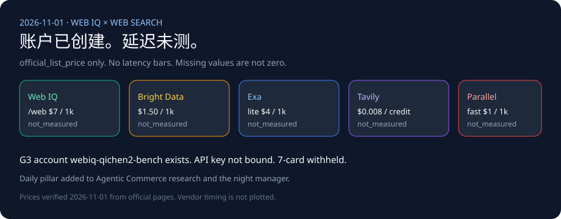

# Web IQ search competitive matrix (2026-11-01)

🌐 **Language / 语言导航**: **[中文](2026-11-01-webiq-search-competitive.md)** | **English (current)** | **[Browse passage note](2026-11-01-webiq-azure-browse-passage.en.md)**

## Finding

The lab paid subscription can create a Web IQ account. G3 account `webiq-qichen2-bench` (`Microsoft.WebIQ/accounts@2026-06-01-preview`, `location=global`, `kind=WebIQ.Grounding`, `statisticsEnabled=false`) was created on 2026-11-01. The API key is not bound, and Bright Data, Exa, Tavily, and Parallel keys are not in the local environment. All five providers stay `not_measured`. Missing latency is not written as zero. The 7-card latency deck stays withheld until a real `summary.json` exists.

The 2026-10-26 sealed figures (P95 240ms, 18/18, 12/12, 1.52s vs 4.18s) remain `sealed_demo`. They are not this bake-off.

## Account status

- Resource group `rg-webiq-bench` in `southeastasia`. The account location is `global`.
- `provisioningState=Succeeded`.
- This note does not publish the subscription ID, internal ID, gateway hostname, or sign-in email.
- https://webiq.microsoft.ai/profiles is where an `x-apikey` is minted. Azure CLI cannot acquire a token for `https://api.microsoft.ai/.default`.
- Browse remains AppID-gated. Auto is not charged while in beta.
- No Bright Data, Exa, Tavily, or Parallel account was created.

The earlier [Browse passage note](2026-11-01-webiq-azure-browse-passage.en.md) recorded a read-only inventory of zero accounts. That Azure status is superseded here. The sealed demo numbers are unchanged.

## Official list prices, not scores

Every row is labeled `official_list_price`. Verified 2026-11-01. These numbers are not latency bars.

| Provider | Official list price | Source | Statement that is not a measurement |
|---|---|---|---|
| Web IQ | `/web`, `/video`, `/news`, `/images` $7 per 1,000; `/browse` $1 per 1,000. Effective 2026-10-16; page updated 2026-10-29. | [Pricing](https://learn.microsoft.com/en-us/web-iq/resources/pricing) | Uncharged Auto beta is not a latency figure. |
| Bright Data SERP | 5,000 free requests per month; pay as you go $1.50 per 1,000 successful requests; Scale $499/month includes 380,000, then $1.30 per 1,000. The page says displayed prices can be local-currency estimates and USD is binding. | [SERP pricing](https://brightdata.com/pricing/serp) | "Under 1 second" is marketing, not a measurement. |
| Exa | Lite / instant search $4 per 1,000 for up to 10 results; auto / fast $7 per 1,000; contents $1 per 1,000 pages; extra results $1 per 1,000. | [Pricing](https://exa.ai/pricing) | No latency from this run. |
| Tavily | Basic search 1 credit, advanced search 2 credits; pay as you go $0.008 per credit; 1,000 free credits per month. | [API credits](https://docs.tavily.com/documentation/api-credits) | No latency from this run. |
| Parallel | Turbo / fast $1 per 1,000 including 10 results; basic / advanced $5 per 1,000; extract $1 per 1,000 URLs. | [Pricing](https://docs.parallel.ai/getting-started/pricing) | The page's 200 ms–3 s range is `vendor_stated`, not a measurement from this repo. |

## Offline contract

[`lab/webiq_search_bakeoff.py`](../../lab/webiq_search_bakeoff.py) never opens a network connection. Three sealed questions cover the return window, a citable price page, and whether a public recall should stop replenishment. When a key is missing, `latency`, `success`, and `citation_check` are `not_measured`. When a key is present, the row records `credential=present` and `call=not_called`. It still does not make a paid call.

The daily research task now has a mandatory pillar: Web IQ versus Bright Data, Exa, and mainstream web search. The night-manager check must verify that pillar. Missing credentials stay `not_measured`.

## Architectural boundary: Microsoft Web IQ caller-visible passages vs. Foundry Grounding with Bing Search

Verified on 2026-11-01 against official Microsoft Learn documentation ([Web IQ Browse Reference](https://learn.microsoft.com/en-us/web-iq/reference/browse), [Web IQ Error Handling](https://learn.microsoft.com/en-us/web-iq/reference/error-handling), and [Foundry Agents Web Grounding Overview](https://learn.microsoft.com/en-us/azure/foundry/agents/how-to/tools/web-overview)):

| Dimension | Microsoft Web IQ (`/v3/search/web`, `/v3/browse`) | Microsoft Foundry Grounding with Bing Search | Agentic Commerce Architectural Impact |
|---|---|---|---|
| **Caller visibility of raw retrieved passages** | **Returned directly to caller code** (`results[].content`, `contentFormat="passage"` default $\le 3000$ chars) | **Hidden from caller code** (raw search chunks stay inside the managed Foundry boundary; caller only receives the model synthesis + citation URLs) | Deterministic pre-LLM prompt-injection scrubbing (`PROMPT_INJECTION_RE`) and SHA-256 price digest verification (`CheckoutStore`) require **Web IQ** rather than opaque model-only grounding |
| **Dual-format `retryAfter` contract** | `AuthUserThrottled` (429) & `InternalServerError` (500) emit duration strings (`"60s"`), whereas `Browse 202` and `TooManyOnDemandCrawls` (**also HTTP 429!**), `520`, `523`, and `524` emit ISO-8601 UTC timestamps (`"2026-10-30T01:01:00Z"`) | Abstracted inside the managed Foundry tool | Callers cannot infer `retryAfter` syntax from `status == 429` alone; enforced by `parse_webiq_retry_after()` and `classify_webiq_error_response()` in `lab/webiq_commerce_demo.py` |

## Not measured

The live bake-off is still blocked: the Web IQ key has to be bound in the portal, and competitor keys are not in the environment. No latency 7-card is published until then.
